# Projeto de uma fonte chaveada flyback 12 V / 3 A com entrada universal e controle por UC3845

**Disciplina:** ELP22109 – Eletrônica de Potência II (2026-2) · **Projeto Semestral – Tema II**
**Aluno:** Mateus Salgado Barboza Costa · **Professor:** Joabel Moia · **Instituição:** IFSC – Campus Florianópolis, Engenharia Eletrônica
**Data:** dezembro de 2026

## 1. Introdução

O objetivo deste trabalho é realizar o projeto completo de um conversor estático segundo o Tema II do projeto semestral: retificador em ponte completa a diodos com filtro capacitivo seguido de uma fonte chaveada **flyback**, com o circuito integrado dedicado **UC3845**, proteções contra surtos da rede, filtro de EMI, grampeamento de tensão sobre o transistor (snubber) e malha fechada da tensão de saída. O produto idealizado é uma fonte de alimentação CA-CC de **36 W (12 V / 3 A)** com entrada universal **90–264 VAC**, da mesma classe das fontes de mesa de roteadores, modems, câmeras de CFTV, fitas de LED e pequenos equipamentos de automação. O enunciado prevê validação em 127 V e 220 V, de modo que o projeto cobre as duas redes brasileiras com margem.

O circuito recebe a rede, limita o surto de ligação (NTC), absorve sobretensões (varistor), filtra a interferência conduzida (X2, choke de modo comum, Y1), retifica e armazena energia no capacitor de *bulk*, e transfere a energia ao secundário por um transformador flyback comutado a 65 kHz por um MOSFET de 650 V comandado em modo corrente de pico pelo UC3845. A saída é retificada por um diodo Schottky, filtrada por um banco de capacitores de baixa RSE e um pós-filtro LC, e regulada por uma malha com TL431 e optoacoplador, que mantém a isolação galvânica.

Foi adotada a **Possibilidade I** (projeto sem bancada, com a Tarefa Extra), mas todos os entregáveis foram preparados para servir à Possibilidade II: a placa está roteada, verificada e com Gerbers prontos, há lista de compra e um guia de montagem e ensaio (`08_Montagem/GUIA_MONTAGEM.md`), de modo que a decisão de montar o protótipo pode ser tomada com o custo e o prazo conhecidos.

## 2. Fundamentação teórica

### 2.1 Conversor flyback em condução descontínua com controle por corrente de pico

No flyback, durante a condução do MOSFET (intervalo D·T) o primário do transformador (na verdade um indutor acoplado) recebe a tensão de *bulk* Vb e a corrente cresce linearmente até Ip = Vb·D·T/Lp, armazenando a energia W = ½·Lp·Ip²; com o transistor bloqueado, a energia é entregue ao secundário pelo diodo, com corrente de pico Is,pk = n·Ip (n = Np/Ns), que decresce com inclinação (Vo+Vf)/Ls durante D2·T. Projetou-se o conversor em **modo de condução descontínua (MCD)** na pior condição (Vb,mín em 90 VAC e plena carga), pelo método da Aula 04C (Barbi): Ip = 2·Po/(η·Vb,mín·Dmáx), Lp = Vb,mín·Dmáx/(Ip·fs) e tensão refletida Vr = Dmáx/(1−Dmáx)·Vb,mín, o que define n = Vr/(Vo+Vf). No MCD a potência transferida é P = ½·Lp·Ip²·fs·η, independente da tensão de entrada: o controle por **corrente de pico** fixa Ip ciclo a ciclo e torna a planta de primeira ordem (polo em fp = 1/(π·Ro·Co)), o que simplifica a compensação e dá limitação de corrente inerente. Durante o bloqueio, o MOSFET suporta Vb + Vr mais a sobretensão da indutância de dispersão Llk, que precisa ser grampeada.

### 2.2 Estágio de entrada, proteções e qualidade de energia

A ponte com filtro capacitivo conduz apenas perto do pico da rede (Aula 06): a corrente de entrada é pulsada, com fator de potência da ordem de 0,4–0,6 e distorção harmônica elevada, aceitáveis para uma fonte de 36 W (abaixo dos 75 W da IEC 61000-3-2 classe D). O capacitor de *bulk* é escolhido pela tensão mínima que deve manter no vale (regra prática de 2–3 µF/W para entrada universal), e dele decorrem a corrente eficaz no capacitor e nos diodos. As proteções seguem a Aula 07: fusível de ação lenta (2–3× a corrente eficaz de entrada), NTC para limitar a corrente de *inrush* no capacitor de *bulk*, varistor de 275 VAC para surtos, e grampo RCD no dreno do MOSFET. O filtro de EMI (Aula 08) combina capacitores X2 (modo diferencial), um choke de modo comum e um capacitor Y1 entre os terras do primário e do secundário.

### 2.3 Projeto do transformador em alta frequência (Aula 04C)

O produto de áreas mínimo do núcleo é AeAw = 1,1·Po·10⁴/(kw·kp·J·fs·Bmáx), o entreferro lg = 2·µ0·W/(B²·Ae) armazena a energia W = Po/(η·fs), e o número de espiras do primário Np = B·lg/(µ0·Ip). A bitola dos condutores é limitada pelo efeito pelicular, Δ = 7,5/√fs (cm), com fios em paralelo para a corrente eficaz com J = 450 A/cm². Verificam-se a ocupação da janela (Kocup ≤ 0,7), as perdas no núcleo (curva do material IP12R) e no cobre, e a elevação de temperatura ΔT = (Pnúcleo+Pcobre)·Rt, com Rt = 23·(AeAw)−0,37.

### 2.4 Perdas nos semicondutores e dissipadores (Aula 02)

As perdas no MOSFET são de condução, RDS(on)(Tj)·Irms², e de comutação, ½·V·I·(tr+tf)·fs mais a energia da capacitância de saída Coss; no flyback em MCD o MOSFET liga com corrente nula, de modo que a perda de ligação se resume à descarga de Coss, e a perda de desligamento depende do tempo de queda efetivo imposto pelo circuito de gate (Qgd, resistor de gate e capacidade de dreno do driver). O diodo Schottky dissipa V0·Iméd + Rd·Irms² sem perda de recuperação reversa. Com a temperatura de junção de projeto (125 °C) e a ambiente (40 °C) determina-se a resistência térmica máxima do dissipador, RθSA = (Tj − Ta)/P − RθJC − RθCS, como nas Tarefas 1 e 2.

### 2.5 Circuito de comando com o UC3845 (Aula 05)

O UC3845 é um controlador PWM de modo corrente com oscilador programado por RT e CT (fosc ≈ 1,72/(RT·CT)), flip-flop que limita a razão cíclica a 50 % (fsw = fosc/2), comparador de corrente com limiar de 1 V no pino ISENSE, amplificador de erro com saída em COMP, referência de 5 V, UVLO de 8,4/7,6 V e saída totem-pole de 1 A capaz de acionar o MOSFET diretamente. A partida é feita por um resistor do *bulk* ao VCC e, em regime, por um enrolamento auxiliar; o resistor de sensoriamento define o limite de corrente de pico, e um filtro RC remove o pico de borda da corrente do primário. Em malha fechada, o TL431 compara uma amostra de Vo com 2,495 V e, por meio do LED do optoacoplador, puxa o pino COMP para baixo; o compensador tipo 2 (Rz, Cz no TL431) coloca um zero sobre o polo da planta e fixa a frequência de cruzamento com margem de fase ≥ 45°.

### 2.6 Layout de PCI (Aula 08 e IPC-2221)

As regras adotadas foram: fluxo de potência linear (entrada de um lado, saída do outro), agrupamento por função, laços de alta frequência curtos, trilhas sem cantos de 90° (chanfros a 45°), separação dos terras de sinal e de potência com um único ponto de união, capacitor de 100 nF junto ao VCC do CI, largura de trilha e distâncias por corrente e tensão (IPC-2221), isolação primário–secundário ≥ 6 mm com fendas sob o transformador e o optoacoplador, plano de terra na face inferior, pontos de teste e regras de DFM para a montagem.

## 3. Materiais e métodos

O projeto foi executado em oito etapas, todas automatizadas por scripts (Python 3 com numpy/matplotlib; LTspice XVII em lote; KiCad 10 por `kicad-cli` e pela API `pcbnew`), de modo que qualquer alteração de parâmetro pode ser propagada até a placa:

1. **Especificação** (`01_Especificacao/requisitos.md`): requisitos elétricos, aplicações, diagrama de blocos e checklist do enunciado.
2. **Cálculos teóricos** (`02_Calculos/*.py` → `resultados/RESULTADOS_TEORIA.md` e `*.json`): parâmetros globais em `params.py` (Vo = 12 V, Io = 3 A, η = 0,82, fs = 65 kHz, Dmáx = 0,43, Ta = 40 °C, Tj = 125 °C); estágio de entrada por simulação numérica do retificador com capacitor (`entrada.py`); flyback pelo método da Aula 04C (`flyback.py`, `transformador.py`, com a tabela de núcleos Thornton); filtro de saída pelos seis critérios da Aula 03 (`saida.py`); snubber RCD (`snubber.py`); componentes do UC3845 (`uc3845.py`); semicondutores, perdas e dissipadores com o mesmo modelo das Tarefas 1 e 2 (`semicondutores.py`); compensador (`compensador.py`); filtro de EMI (`emi.py`).
3. **Simulação** (`03_Simulacao/`): netlists LTspice geradas por `gera_netlist.py` com modelo comportamental próprio do UC3845 (oscilador, latch de 50 %, comparador de corrente com limiar de 1 V, UVLO 8,4/7,6 V, driver com Rg), modelo VDMOS do STP13N65M2 (RDS(on), Cgd, Coss do datasheet), TL431 e PC817 comportamentais, indutância de dispersão e RSE dos capacitores explícitas. Foram simulados 20 casos: regime permanente em 90/127/220/264 VAC × 10/50/100 % de carga, partida em 90 e 264 VAC, degrau de carga 50→100 % em 90 e 264 VAC, curto-circuito na saída, operação sem snubber, Llk = 3 % e optoacoplador com CTR = 0,5. Os resultados (`.raw`) foram lidos em Python e as medidas consolidadas em `runs/medidas.json`; as tabelas teoria × simulação do relatório são geradas por `06_Relatorio/gera_tabelas.py`.
4. **Ciclo de ajuste**: cada divergência relevante entre teoria e simulação motivou uma revisão dos scripts (seção 4.6), repetindo o lote até fechar.
5. **Esquemático** (`04_KiCad/gera_sch.py` → `fonte_flyback_12V3A.kicad_sch`): gerado por script com os valores finais; ERC sem erros; PDF, netlist e BOM exportados por `kicad-cli`.
6. **Layout** (`placement.py`, `router.py`, `gera_pcb.py`): posicionamento com verificação de sobreposição de *courtyards*, roteador próprio em duas camadas com classes de rede (HV, SEC, SEC_PWR), regras de projeto em `fonte_flyback_12V3A.kicad_dru`, chanfros a 45°, ilha de terra de sinal e verificação de continuidade do plano; DRC com paridade com o esquemático; Gerbers, furação, imagens e render 3D.
7. **BOM e custo** (`05_BOM_Custo/bom.py` → `BOM.xlsx`, `custo.xlsx`), com part numbers, distribuidor e preços de referência para 1 e 100 unidades, incluindo a PCI.
8. **Guia de montagem e ensaio** (`08_Montagem/GUIA_MONTAGEM.md`) e modelo da Tarefa Extra (`09_Tarefa_Extra/`).

Hipóteses de projeto: rendimento 82 % (verificado a posteriori pelo orçamento de perdas), Dmáx = 0,43 (margem sobre os 46–50 % do UC3845), Bmáx = 0,25 T, J = 450 A/cm², kw = 0,4, kp = 0,3, grampo em 1,8·Vr, Llk = 2 % de Lp (verificação a 3 %), temperatura ambiente 40 °C.

## 4. Resultados

### 4.1 Requisitos e características elétricas

| Grandeza | Valor |
|---|---|
| Tensão de entrada | 90–264 VAC, 50/60 Hz (nominais 127 e 220 V) |
| Saída | 12,0 V ± 5 %, 0,3–3,0 A (36 W), ondulação ≤ 120 mV p-p |
| Frequência de comutação | 65 kHz (UC3845, D ≤ 0,5) |
| Rendimento (meta / hipótese) | ≥ 85 % / 82 % |
| Proteções | fusível T2A, NTC 10 Ω, varistor S14K275, limitação de corrente ciclo a ciclo, curto-circuito, grampo RCD |
| EMI | X2 220 nF + choke MC 10 mH + X2 100 nF, Y1 2,2 nF |
| Isolação | transformador + optoacoplador; ≥ 6 mm na PCI |
| Potência de entrada | 43,9 W em plena carga (η = 0,82) |

**Estágio de entrada.** A simulação numérica do retificador com capacitor (fig. 1) levou à escolha de **Cbulk = 100 µF / 400 V** (2,8 µF/W): tensão mínima de 94,6 V em 90 VAC/50 Hz (ondulação 29,8 V), corrente eficaz no capacitor 0,76 A, corrente eficaz de entrada 0,86 A, fator de potência 0,60 (119 % de THD) em 90 V e 0,43 em 220 V — típico de retificador com filtro capacitivo (Aula 06). Proteções: fusível **T 2 A/250 V** (2,5 × 0,86 A), **NTC 10 Ω** (inrush de 187 A sem NTC para 31 A), varistor **S14K275**, ponte **GBU4J** (Iméd 0,2 A por diodo, VRRM 600 V ≥ 1,5 × 370 V, IFSM ≥ 100 A).

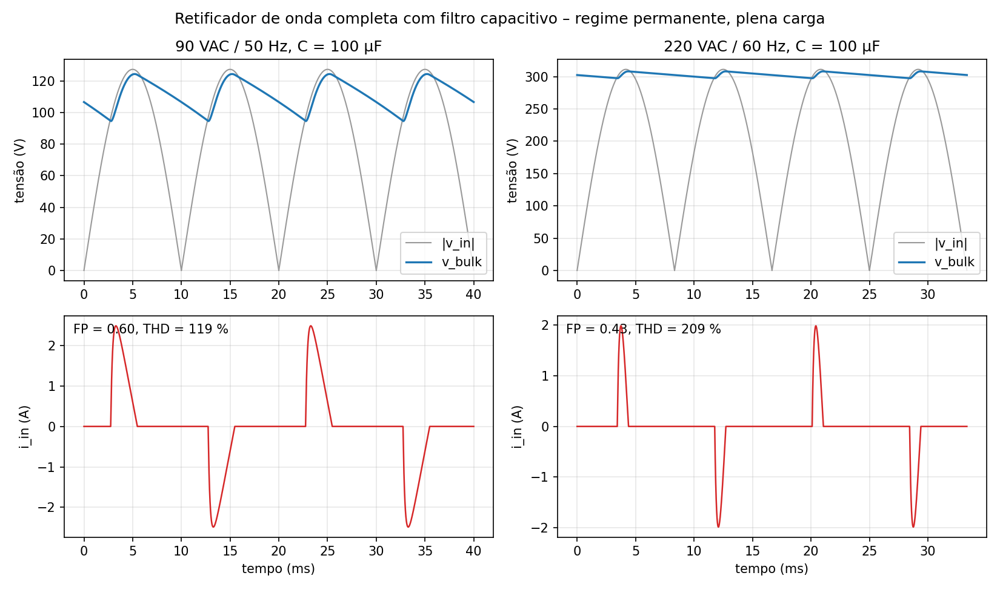

### 4.2 Projeto elétrico do flyback e transformador

Com Vb,mín = 94,6 V e Dmáx = 0,43: Vr = 71,3 V, n = 5,62, Ip = 2,16 A, Lp = 290 µH, W = 675 µJ. O produto de áreas mínimo é 0,451 cm⁴, atendido pelo núcleo **Thornton E-30/7 (NEE-30/15/7, IP12R)**, AeAw = 0,48 cm⁴ (tabela 1): lg = **0,45 mm**, **Np = 42**, **Ns = 7** (n = 6,0, Vr = 76,2 V), **Naux = 9** (Vaux ≈ 15 V), **Lp = 294 µH**, Bpico = 0,25 T. A profundidade de penetração em 65 kHz (0,29 mm) limita o fio a 23 AWG: primário 1 × 23 AWG (Ip,rms = 0,82 A), secundário 5 × 23 AWG (Is,rms = 5,45 A), auxiliar 1 × 28 AWG. Perdas 0,62 W (núcleo) + 0,35 W (cobre) → ΔT = 29 °C; Kocup = 0,46. O núcleo E-30/14, embora caiba, teria o dobro de perdas no núcleo; o E-42/15 ficaria subutilizado (Kocup = 0,08). A ordem de enrolamento (sanduíche: ½ primário, auxiliar, secundário, ½ primário) e a execução do entreferro estão no guia de montagem.

**Tabela 1 – Comparação de núcleos (transformador.py).**

| Núcleo | AeAw (cm⁴) | lg (mm) | Np | Ns | Naux | Lp (µH) | fio prim. | fio sec. | P núcleo (W) | P cobre (W) | ΔT (°C) | Kocup |
|---|---|---|---|---|---|---|---|---|---|---|---|---|
| **E-30/7** | 0,48 | 0,45 | 42 | 7 | 9 | 294 | 1×23 | 5×23 | 0,62 | 0,35 | 29,1 | 0,46 |
| E-30/14 | 1,02 | 0,23 | 21 | 3 | 4 | 294 | 1×23 | 6×23 | 1,23 | 0,19 | 32,4 | 0,22 |
| E-42/15 | 2,84 | 0,15 | 14 | 2 | 3 | 297 | 1×23 | 6×23 | 2,63 | 0,16 | 43,7 | 0,08 |

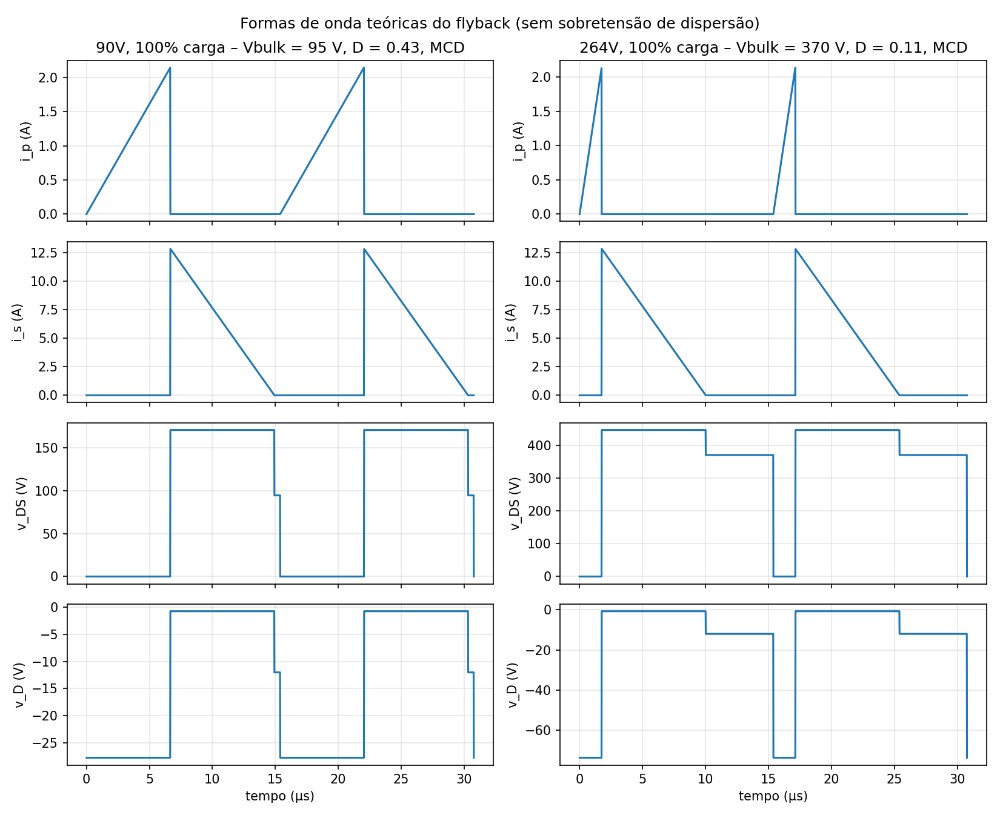

**Esforços teóricos (tabela 2).** Em toda a faixa o conversor opera em MCD com Ip = 2,14 A; a razão cíclica vai de 0,43 (90 V) a 0,11 (264 V), o tempo de condução mínimo é 554 ns (264 V, 10 %), acima do mínimo do UC3845. A tensão máxima no MOSFET com grampo a 1,8·Vr é **507 V** em 264 VAC (78 % de 650 V); a tensão reversa no diodo de saída é 74 V (Schottky de 100 V); a corrente eficaz nos capacitores de saída é 4,54 A.

**Tabela 2 – Esforços teóricos por ponto de operação (flyback.py).**

| Vac | carga | D | ton (ns) | Ip (A) | Ip,rms (A) | Is,pk (A) | Is,rms (A) | Ic,rms (A) | Vds grampo (V) | Vd,rev (V) |
|---|---|---|---|---|---|---|---|---|---|---|
| 90 | 100 % | 0,433 | 6663 | 2,14 | 0,815 | 12,9 | 5,45 | 4,54 | 261 | 33 |
| 127 | 100 % | 0,264 | 4058 | 2,14 | 0,636 | 12,9 | 5,45 | 4,54 | 314 | 41 |
| 220 | 100 % | 0,139 | 2133 | 2,14 | 0,461 | 12,9 | 5,45 | 4,54 | 445 | 63 |
| 264 | 100 % | 0,114 | 1752 | 2,14 | 0,418 | 12,9 | 5,45 | 4,54 | 507 | 74 |
| 264 | 10 % | 0,036 | 554 | 0,68 | 0,074 | 4,1 | 0,97 | 0,92 | 507 | 74 |

### 4.3 Escolha dos capacitores, filtro de saída e snubber

**Capacitores de saída (Aula 03).** Cmín = 427 µF para ΔVC = 50 mV; a RSE máxima para 120 mV sem pós-filtro seria 5,4 mΩ, impraticável com um único eletrolítico, de modo que se adotou um banco de **3 × Rubycon ZLH 1000 µF/25 V** (RSE equivalente 6,3 mΩ, corrente de ondulação admissível 6,0 A ≥ 4,54 A, ΔV1 = 89 mV) seguido de **pós-filtro LC 3,3 µH + 470 µF** (fc = 4,0 kHz, −30 dB em 65 kHz), resultando em ondulação teórica de 2,7 mV (fig. 3). Demais capacitores: bulk 100 µF/400 V 105 °C (Nichicon UCY), VCC 220 µF/35 V + 100 nF, VREF 1 µF, CT 2,2 nF C0G, X2 220 nF e 100 nF, Y1 2,2 nF (fuga 0,21 mA < 0,25 mA, classe II), snubber 22 nF/630 V de filme.

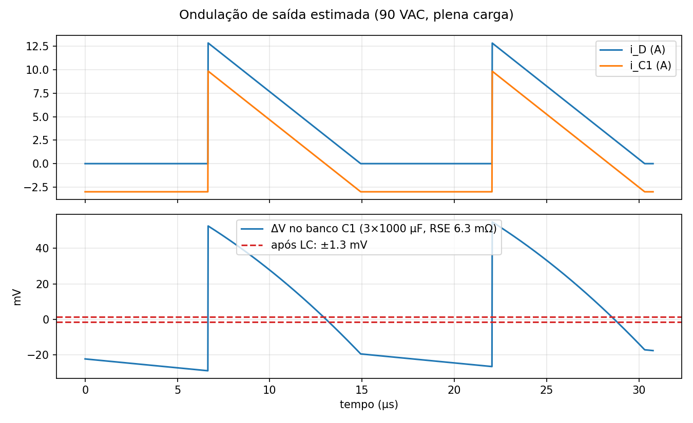

**Snubber RCD (Aula 07).** Com Llk = 2 % de Lp (5,9 µH) e grampo Vc = 1,8·Vr = 137 V, a energia por ciclo é 13,5 µJ e a potência 2,0 W: **R = 9,1 kΩ (2 × 18,2 kΩ / 2 W em paralelo)**, **C = 22 nF / 630 V**, diodo **UF4007**. Para Llk = 3 % a potência sobe a 2,6 W e Vds a 524 V (81 %). A alternativa com TVS P6KE180A foi descartada por deixar Vds em 616 V (95 %). No diodo de saída, um RC de amortecimento de 15 Ω + 2,2 nF/100 V (fring ≈ 14 MHz) limita o ringing (fig. 4).

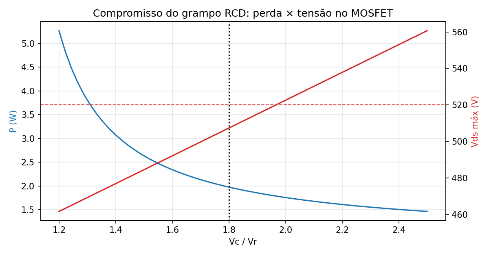

### 4.4 Escolha dos diodos, do transistor, perdas e dissipadores

**Pré-escolha (Aula 03).** MOSFET: Vds ≤ 80 % → classe 650 V, ID ≥ 4 A, TO-220; diodo de saída: Schottky 100 V, ≥ 10 A; ponte 600 V / 2–4 A. Foram comparados três MOSFETs (tabela 3) com o modelo de perdas das Tarefas 1 e 2 (RDS(on) a 125 °C, descarga de Coss, desligamento com tf efetivo imposto pelo gate, perda de gate).

**Tabela 3 – MOSFETs candidatos, perdas em plena carga e dissipador (semicondutores.py).**

| MOSFET | RDS(on) 25 °C (mΩ) | Qg (nC) | Ptot 90 V (W) | Ptot 264 V (W) | RθJC (°C/W) | RθSA máx (°C/W) | dissipador | Tj (°C) |
|---|---|---|---|---|---|---|---|---|
| IPA65R400CE (Infineon, TO-220FP) | 400 | 20 | 1,14 | 1,38 | 4,0 | 57 | clip Aavid 574502 | 79 |
| **STP13N65M2 (ST MDmesh M2, TO-220)** | 430 | 17 | 1,04 | 1,15 | 1,14 | 72 | clip Aavid 574502 | 69 |
| FCPF190N65S3 (onsemi, TO-220F) | 190 | 34 | 0,83 | 1,40 | 3,5 | 57 | clip Aavid 574502 | 79 |

Escolhido o **STP13N65M2** (menor perda total no pior caso, 1,15 W em 264 V; sem dissipador Tj seria 112 °C, acima da margem adotada de 100 °C, por isso o clip de 24 °C/W com mica e pasta → Tj ≈ 69 °C). Como o componente está em falta em alguns distribuidores, a BOM lista substitutos diretos (STF13N65M2, IPA65R400CE). **Diodo de saída: STPS20H100CT** (dois diodos de 10 A/100 V em paralelo): P = 1,78 W, clip de 24 °C/W → Tj ≈ 84 °C (tabela 4). **Ponte GBU4J**: 0,69 W, Tj ≈ 54 °C sem dissipador. Diodo do snubber UF4007, do auxiliar UF4004, do gate 1N4148.

**Tabela 4 – Diodos de saída candidatos (semicondutores.py).**

| Diodo | V0 (V) | Rd (mΩ) | P (W) | RθJC | RθSA máx | Tj (°C) |
|---|---|---|---|---|---|---|
| **STPS20H100CT – ânodos em paralelo** | 0,55 | 4,5 | 1,78 | 0,45 | 46,7 | 84 |
| STPS20H100CT – uma perna | 0,55 | 9,0 | 1,92 | 0,90 | 42,9 | 89 |
| MBR20100CT – paralelo | 0,62 | 6,0 | 2,04 | 1,00 | 40,2 | 92 |
| MBR10100 | 0,65 | 12,0 | 2,31 | 2,00 | 34,4 | 101 |

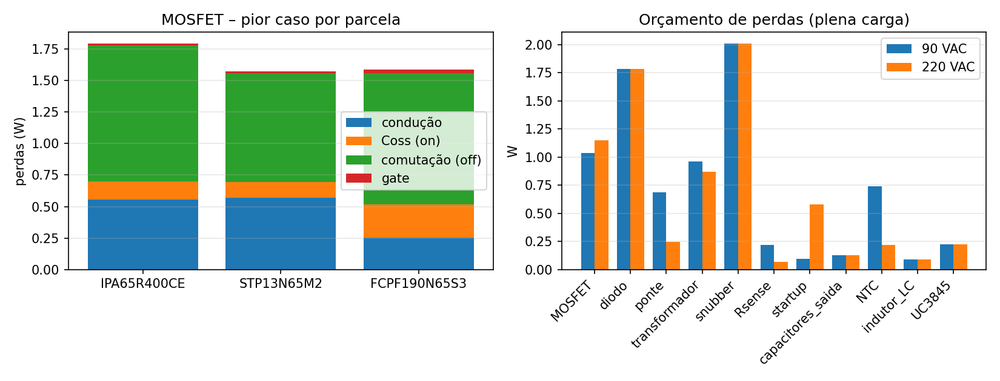

**Orçamento de perdas (tabela 5).** O total varia de 7,4 a 8,0 W, com o snubber (2,0 W), o diodo (1,8 W), o MOSFET (1,0–1,15 W), o transformador (0,9 W) e o NTC (0,74 W em 90 V) como maiores parcelas: η = 81,9–83,0 %, coerente com a hipótese de 82 %.

**Tabela 5 – Orçamento de perdas em plena carga (W).**

| Vac | MOSFET | diodo | ponte | trafo | snubber | Rsense | partida | cap. saída | NTC | LLC | UC3845 | total | η (%) |
|---|---|---|---|---|---|---|---|---|---|---|---|---|---|
| 90 | 1,04 | 1,78 | 0,69 | 0,96 | 2,01 | 0,22 | 0,09 | 0,13 | 0,74 | 0,09 | 0,22 | 7,98 | 81,9 |
| 127 | 1,04 | 1,78 | 0,45 | 0,91 | 2,01 | 0,13 | 0,19 | 0,13 | 0,45 | 0,09 | 0,22 | 7,41 | 82,9 |
| 220 | 1,15 | 1,78 | 0,24 | 0,87 | 2,01 | 0,07 | 0,58 | 0,13 | 0,22 | 0,09 | 0,22 | 7,37 | 83,0 |
| 264 | 1,15 | 1,78 | 0,20 | 0,86 | 2,01 | 0,06 | 0,84 | 0,13 | 0,17 | 0,09 | 0,22 | 7,52 | 82,7 |

### 4.5 Componentes associados ao CI, driver e malha de realimentação

**Oscilador:** RT = 6,04 kΩ (E96), CT = 2,2 nF C0G → fosc = 129,4 kHz, **fsw = 64,7 kHz**. **Sensoriamento:** limite de corrente em 1,25·Ip = 2,68 A → **Rs = 0,33 Ω** (2 × 0,68 Ω / 1 W em paralelo; 0,22 W), limite real 2,7–3,0 A; filtro 1 kΩ / 220 pF (τ = 220 ns < ton,mín/2). **Partida:** 2 × 82 kΩ / 1 W em série do *bulk* ao VCC (corrente mínima 0,53 mA ≥ 0,5 mA no vale de 90 V; partida em 1–4,3 s; 0,84 W em 264 V), CVCC = 220 µF/35 V (sustenta 9,2 ms entre 8,4 e 7,6 V), auxiliar de 15,4 V com UF4004 + 10 Ω. **Driver:** a saída totem-pole de ±1 A do UC3845 aciona diretamente o MOSFET (Qg = 17 nC: 1,1 mA médios a 65 kHz, tempos de borda ≈ 25 ns) — circuito básico não isolado da Aula 05, pois CI e MOSFET compartilham a referência; Rg = 10 Ω, 1N4148 antiparalelo (desligamento rápido) e 10 kΩ gate–source. **Compensação de rampa:** não necessária (MCD, D < 0,5); há provisão na placa. **Realimentação:** divisor Ra = 9,53 kΩ / Rb = 2,49 kΩ (Vo = 12,04 V), RLED = 2,74 kΩ, Rbias = 1 kΩ, pull-up de 4,7 kΩ no COMP com Cp = 1 nF; a planta (modo corrente em MCD) tem ganho 15,9 dB e polo em 22,9 Hz em plena carga; compensador tipo 2 com **Rz = 47,5 kΩ, Cz = 150 nF** (zero em 22 Hz) dá fc = 1,49 kHz e **margem de fase 99°**, mantendo-se ≥ 91° para 10 % de carga e CTR de 0,5 a 1,6 (fig. 6).

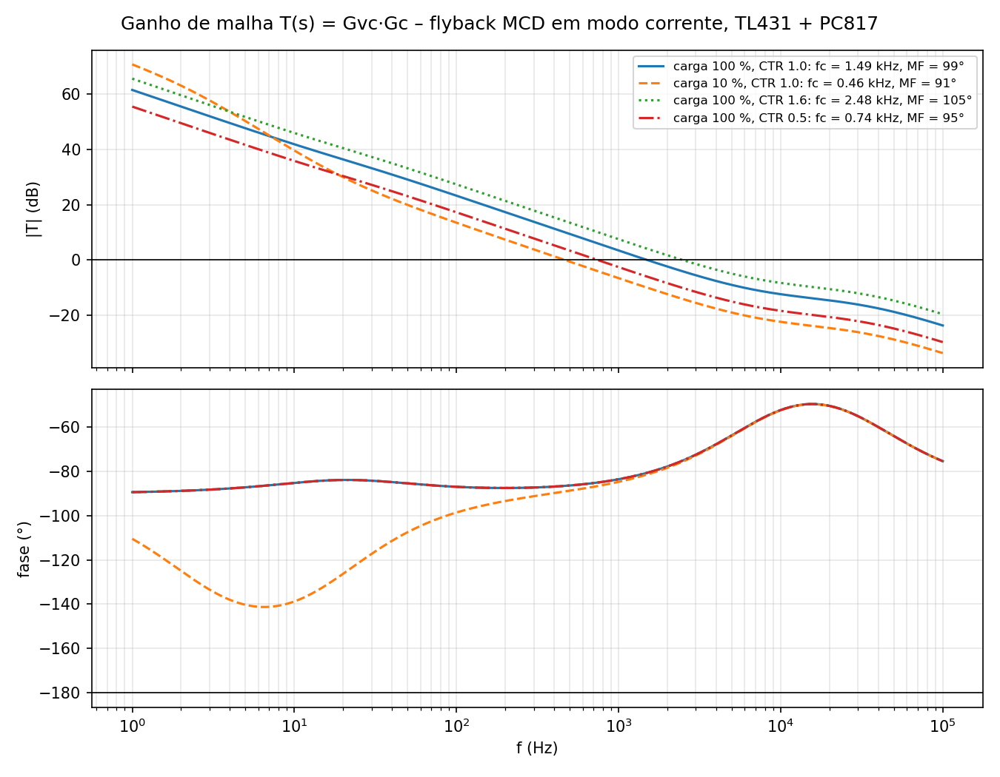

**Filtro de EMI:** choke de modo comum 10 mH (Würth 744821110, dispersão ≈ 200 µH para o modo diferencial), X2 220 nF antes e 100 nF depois, Y1 2,2 nF entre os terras e 2 × 470 kΩ de descarga (34 V em 0,77 s): fDM ≈ 43 kHz (51 dB em 150 kHz), fCM ≈ 24 kHz (26 dB em 150 kHz) (fig. 7).

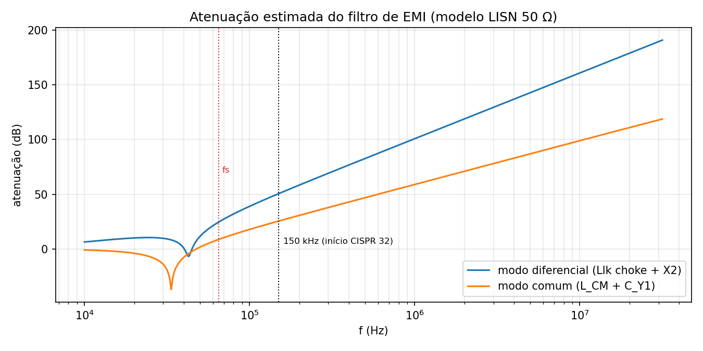

### 4.6 Simulação e comparação com a teoria

A fig. 8 mostra as formas de onda de um ciclo em 90 VAC e 264 VAC, plena carga, e a fig. 9 a partida em 90 VAC e o degrau de carga. A tabela 6 compara os esforços teóricos com os simulados nos 12 pontos de operação e a tabela 7 as perdas e o rendimento em plena carga; a tabela 8 resume os casos especiais.

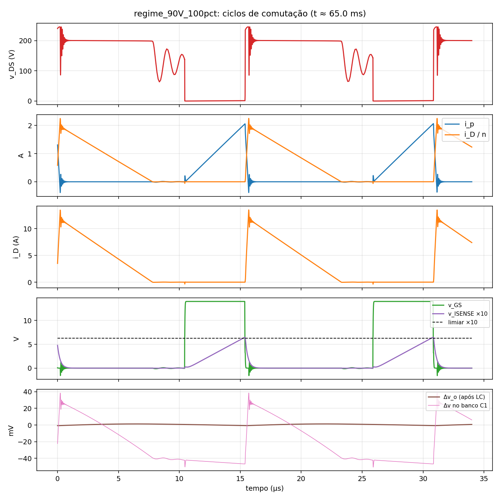

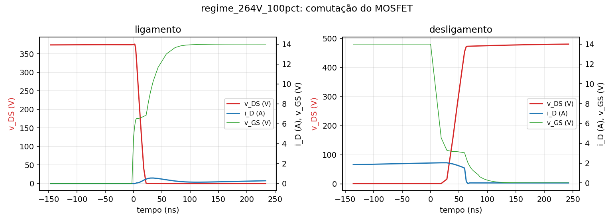

**Tabela 6 – Teoria × simulação em regime permanente (gera_tabelas.py).**

{{regime}}

**Tabela 7 – Perdas e rendimento em plena carga: teoria × simulação.**

{{perdas}}

**Tabela 8 – Casos especiais simulados.**

{{especiais}}

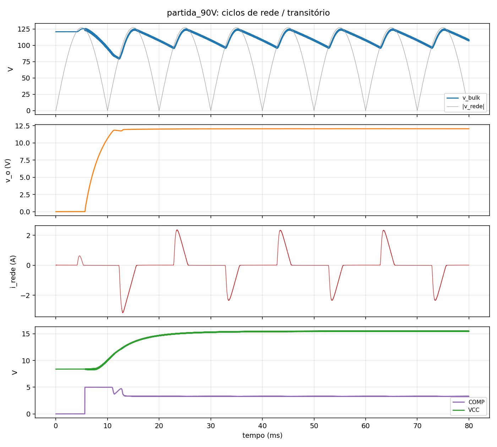

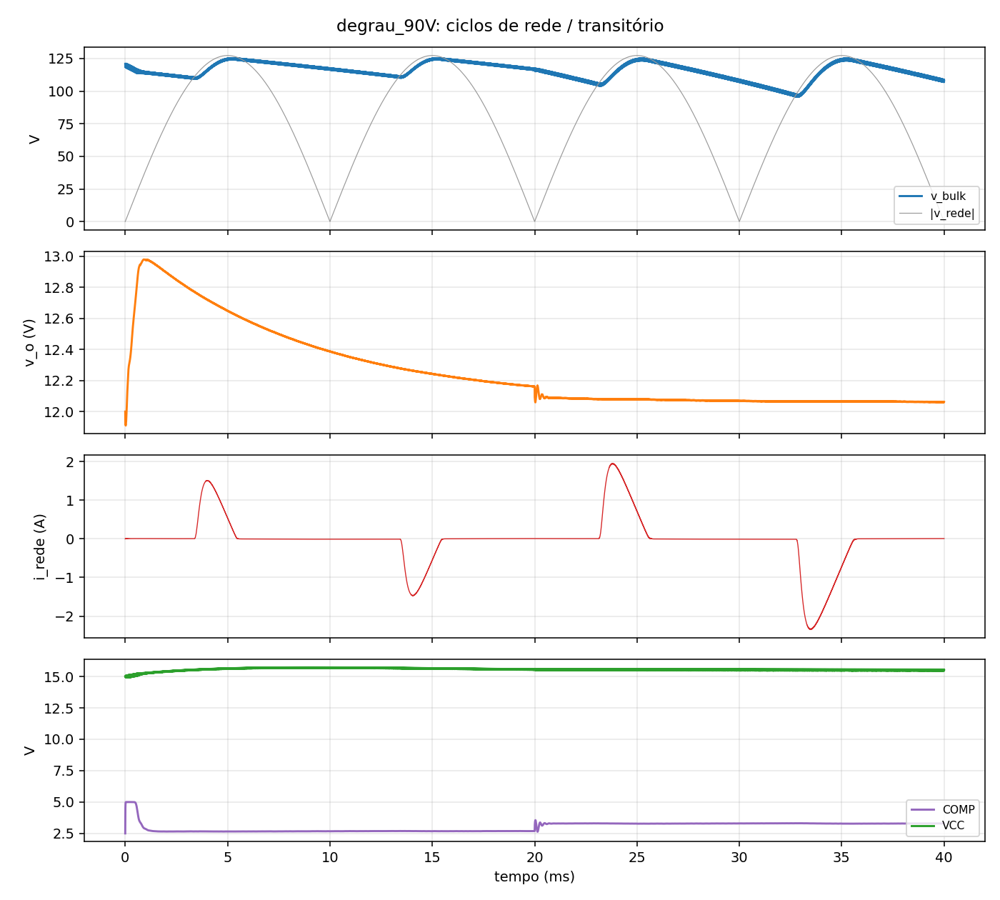

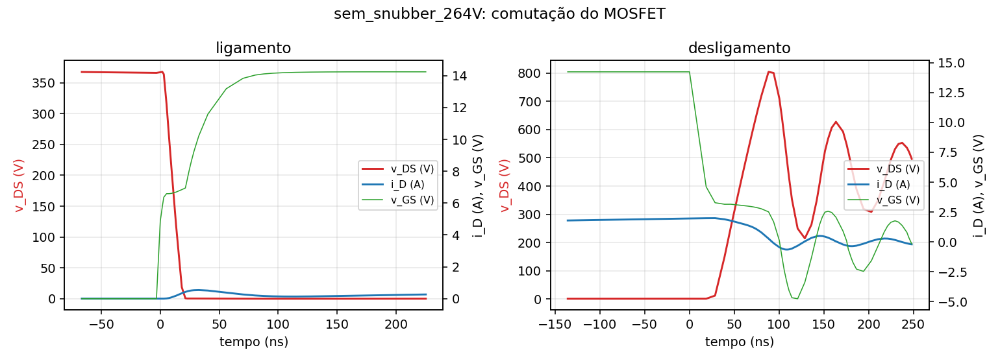

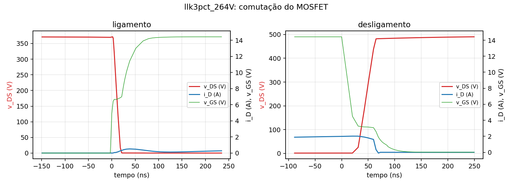

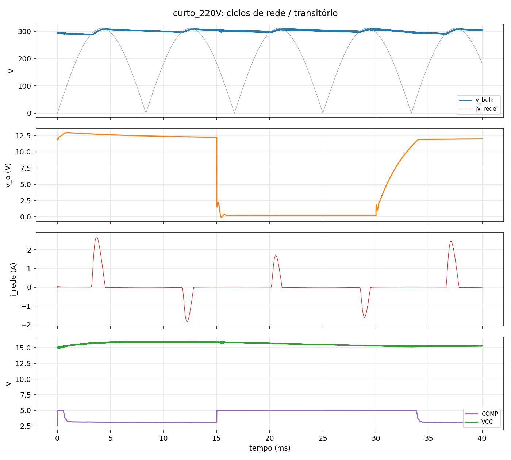

**Análise.** A tensão de saída fica entre 12,07 e 12,08 V em toda a faixa (regulação de linha e carga < 0,1 %), com ondulação de 1–4 mV após o pós-filtro. A corrente de pico do primário difere −3,5 % da teoria (o controle por corrente de pico com o limiar efetivo do comparador a 0,9–1,0 V e o atraso do filtro RC fixam Ip ligeiramente abaixo); a corrente de pico do secundário fica +5 % (dispersão e amortecimento do RC do diodo), e a corrente eficaz do secundário −10 %, porque a teoria assume o triângulo ideal com Vb no vale enquanto a simulação integra sobre o ciclo da rede. A tensão de dreno em plena carga fica 5–6 % abaixo da teoria (grampo real em 1,6–1,7·Vr); em carga leve o grampo cai (menos energia de dispersão), e a diferença chega a −21 %, a favor da segurança. O rendimento simulado (83,3 % em 90 V, 85,5 % em 220 V) é 1–2 pontos superior ao orçamento teórico, principalmente porque o snubber dissipa 1,2–1,5 W (grampo mais baixo) e o MOSFET 0,4–0,9 W (comutação suave em MCD); as perdas no diodo e na ponte coincidem em ±4 %. Em 10 % de carga o rendimento cai para 64–73 % por causa das perdas fixas (snubber, resistores de partida, CI), comportamento esperado em um flyback sem modo *burst*.

Os casos especiais confirmam: partida sem sobretensão em 90 e 264 VAC (Vo máx 12,06 V); degraus de carga sem oscilação (ΔVo < 15 mV, resposta em < 1 ms, coerente com a margem de fase de 99°); mesmo com CTR = 0,5 a malha permanece estável; **sem o snubber a tensão de dreno chega a 828 V (127 % de 650 V), o que comprova a necessidade do grampo**; com Llk = 3 % o pico é 496 V (76 %). No curto-circuito a limitação ciclo a ciclo mantém Ip em 2,7–3,0 A em regime, mas há um transitório de 4,3 A no instante do curto (atraso do filtro de corrente e do driver) e a corrente eficaz no diodo sobe a 17 A enquanto o curto dura: o UC3845 não tem proteção de curto temporizada, e a fonte só reduz a potência quando o VCC auxiliar cai e o CI entra em *hiccup* pelo UVLO. Essa é uma **limitação documentada** do projeto: um produto comercial acrescentaria um circuito de sobrecorrente no secundário ou um CI com temporizador de falha, o que fica como sugestão.

**Ajustes feitos no ciclo teoria → simulação → teoria:** Dmáx reduzido de 0,45 para 0,43 (margem para os 46 % mínimos do UC3845 e para o MCC em 90 V); grampo elevado de 1,5 para 1,8·Vr (menor potência no snubber, Vds ainda ≤ 80 %); η de 0,85 para 0,82 após o orçamento de perdas; Ns escolhido equilibrando as margens de tensão do MOSFET (650 V) e do diodo (100 V); regra de dissipador para Tj > 100 °C; capacitor Y1 com passo de 10 mm e redes HV com largura ≥ 1 mm após o DRC; modelo do MOSFET com Cgd e Coss de catálogo após a primeira simulação, excessivamente ideal, mostrar comutação sem perdas.

**Tabela 9 – Verificação dos critérios de projeto.**

{{criterios}}

### 4.7 Esquemático

O esquemático completo (fig. 12; PDF em `04_KiCad/fonte_flyback_12V3A_esquematico.pdf`) reúne os seis blocos: entrada/proteções/EMI, retificador + bulk, flyback com snubber e Rsense, controle UC3845 com partida e auxiliar, realimentação TL431/PC817 e saída com pós-filtro, além de 11 pontos de teste e 4 furos de fixação. ERC: 0 erros, 0 avisos; 54 componentes, 34 redes.

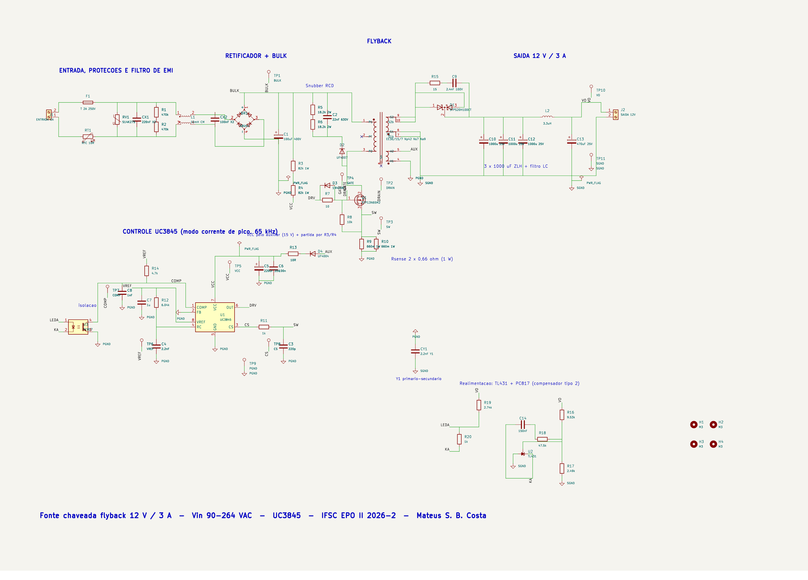

### 4.8 Lista de materiais e custo

A BOM completa (`05_BOM_Custo/BOM.xlsx`, 57 itens) traz part number, fabricante, código de distribuidor e preço de referência para 1 e 100 unidades (catálogos Mouser/Digi-Key/LCSC/RS consultados em outubro de 2026, câmbio adotado R$ 5,50). O custo por fonte é **US$ 39,78 (≈ R$ 219) em 1 unidade** e **US$ 20,63 (≈ R$ 113) em 100 unidades**, incluindo a PCI (tabela 10). Em 1 unidade a placa (lote de 5 com frete) é 24 % do custo; em 100 unidades os maiores blocos são o secundário (diodo com dissipador e capacitores de baixa RSE), o filtro de EMI e o transformador.

**Tabela 10 – Custo por bloco (bom.py).**

| Bloco | Itens | US$ (1 un.) | US$ (100 un.) | % (1 un.) |
|---|---|---|---|---|
| PCI (2 camadas, 140 × 90 mm) | 1 | 9,60 | 1,90 | 24,1 |
| Secundário | 10 | 5,05 | 3,14 | 12,7 |
| Filtro EMI | 6 | 4,51 | 2,97 | 11,3 |
| Transformador | 2 | 4,50 | 3,00 | 11,3 |
| Potência primária | 5 | 3,30 | 2,21 | 8,3 |
| Mecânica (pontos de teste, espaçadores) | 15 | 2,80 | 1,42 | 7,0 |
| Entrada e proteções | 5 | 2,65 | 1,71 | 6,7 |
| Retificador e bulk | 2 | 2,60 | 1,75 | 6,5 |
| Comando UC3845 | 16 | 2,55 | 1,38 | 6,4 |
| Realimentação | 10 | 1,21 | 0,61 | 3,0 |
| Snubber RCD | 4 | 1,01 | 0,54 | 2,5 |
| **Total por fonte** | 76 | **39,78** | **20,63** | 100 |

### 4.9 Layout da PCI

A placa (fig. 13 a 15) tem **140 × 90 mm**, duas camadas, FR-4 de 1,6 mm, cobre de 35 µm e todos os componentes PTH (montagem manual ou por onda). O posicionamento segue o fluxo linear rede → EMI → ponte/bulk → MOSFET/transformador → secundário → saída, com o circuito de comando agrupado abaixo do primário e a realimentação no secundário; o transformador fica sobre a fenda de isolação e o optoacoplador sobre uma segunda fenda. As regras de projeto (`fonte_flyback_12V3A.kicad_dru`, classes HV/SEC/SEC_PWR) impõem isolamento ≥ 1,0 mm nas redes de alta tensão (IPC-2221 B4 para 301–500 V com máscara: 0,8 mm), **≥ 6 mm entre primário e secundário**, trilhas ≥ 1,0 mm nas redes HV, 2,0 mm no secundário de potência (5,45 A rms) e 1,5 mm no bulk. O roteador substitui os cantos de 90° por chanfros a 45° (222 chanfros; os ângulos retos restantes são saídas de trilhas em pads). O terra de potência (plano inferior sob o primário) e o terra de sinal (ilha sob o UC3845, opto e auxiliares) são zonas separadas unidas por uma única trilha no lado frio do Rsense, e o roteador verifica que a ilha permanece contínua; o capacitor de 100 nF fica a 4,3 mm do pino VCC. Resultado do DRC (`kicad-cli pcb drc --severity-all --schematic-parity`): **0 erros, 0 itens não conectados, 0 divergências com o esquemático**, 4 avisos de serigrafia (opto sobre a fenda, intencional). A verificação item a item contra a Aula 08 está em `04_KiCad/VERIFICACAO_LAYOUT.md`; os arquivos de fabricação (Gerbers RS-274X e furação Excellon) em `04_KiCad/gerbers/`.

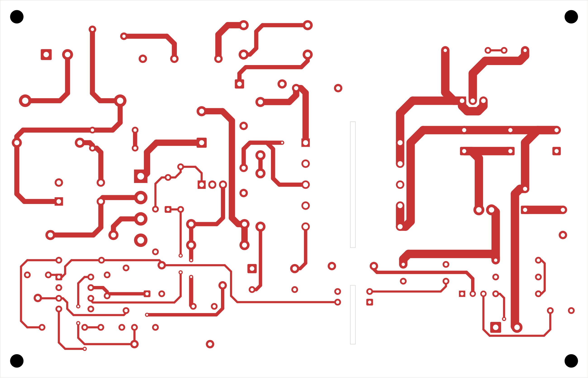

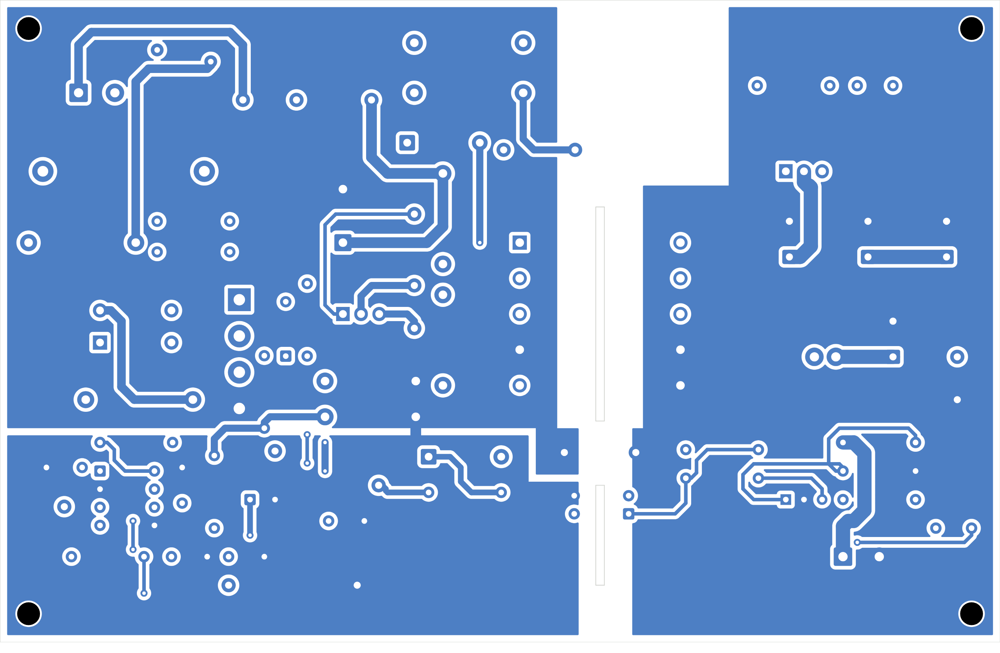

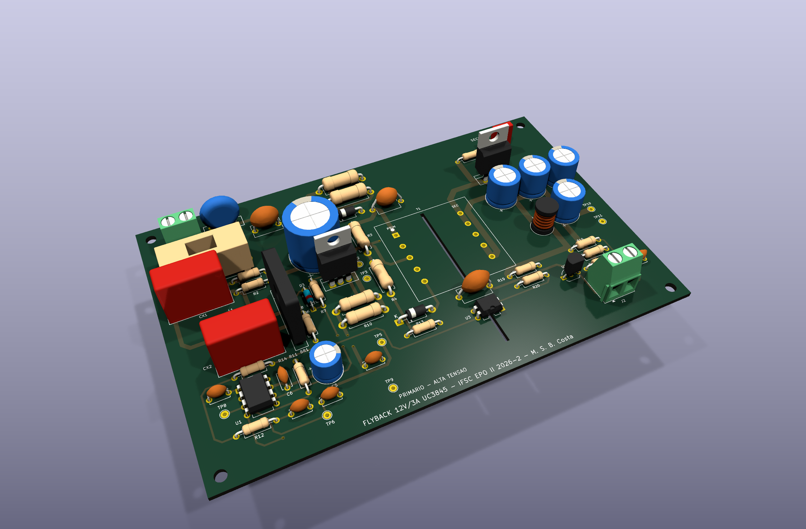

### 4.10 Montagem e ensaio (preparação para a Possibilidade II)

O guia `08_Montagem/GUIA_MONTAGEM.md` contém a lista de compra com alternativas nacionais, o procedimento de enrolar o transformador (ordem em sanduíche, isolação, entreferro, medida de Lp = 294 µH ± 10 % e Llk < 9 µH), a montagem por blocos com teste de cada um (entrada, controle com fonte de bancada, potência em tensão reduzida com lâmpada em série, tensão plena, proteções), a tabela de grandezas esperadas com critério de aceite e um guia de diagnóstico. Os resultados experimentais, se o protótipo for montado, entram na tabela 6 como terceira coluna.

## 5. Conclusão

O projeto atingiu o objetivo da introdução: uma fonte flyback de 12 V / 3 A com entrada universal e UC3845 foi especificada, calculada, simulada, ajustada e levada até o layout final verificado. Os resultados da simulação confirmam a teoria dentro de 10 % nos esforços de corrente e tensão, com regulação melhor que 0,1 %, ondulação de poucos milivolts, Vds máximo de 482–496 V (74–76 % de 650 V), partida e degraus de carga estáveis (margem de fase de 99°) e rendimento de 83–85,5 % em plena carga, acima da hipótese de projeto de 82 % e no limite da meta de 85 %; as maiores parcelas de perda são o snubber, o diodo de saída e o NTC. A simulação sem snubber (828 V) demonstra que o grampo é indispensável, e o ensaio de curto-circuito mostra a limitação do UC3845 sem temporizador de falha, apontando uma melhoria para um produto. Todos os itens do enunciado foram cobertos: requisitos e aplicações, simulações, esquemático, projeto físico do transformador, capacitores, diodos, componentes do CI, driver, transistor com perdas e dissipador, BOM com part numbers e custo (US$ 39,78 por unidade; US$ 20,63 em 100) e layout com potência e comando, seguindo as práticas da Aula 08 e a IPC-2221. Como trabalhos futuros, sugerem-se a proteção de sobrecorrente no secundário, um modo *burst* para elevar o rendimento em carga leve, a medição de Llk do transformador real para fechar o dimensionamento do snubber e, se houver bancada, a montagem do protótipo com o roteiro preparado.

## 6. Referências bibliográficas

1. MOIA, J. *Apresentações das Aulas 01 a 08 – Eletrônica de Potência II*. IFSC, 2026 (revisão de eletrônica de potência; perdas e dissipadores; metodologia de projeto; eletromagnetismo, indutores e transformadores em alta frequência; circuitos de comando; QEE e correção do fator de potência; fontes chaveadas; layout de PCI com DFM).
2. BARBI, I. *Projeto de fontes chaveadas*. Florianópolis: Edição do Autor, 2003.
3. BARBI, I. *Eletrônica de potência*. 5. ed. Florianópolis: Edição do Autor, 2005.
4. ERICKSON, R. W.; MAKSIMOVIĆ, D. *Fundamentals of power electronics*. 2. ed. Norwell: Kluwer, 2001.
5. MOHAN, N.; UNDELAND, T.; ROBBINS, W. *Power electronics: converters, applications and design*. 2. ed. New York: Wiley, 1995.
6. TEXAS INSTRUMENTS. *UCx84x Current-Mode PWM Controllers* (datasheet SLUS223H). 2024.
7. STMICROELECTRONICS. *STP13N65M2 – N-channel 650 V, 0.43 Ω typ., 11 A MDmesh M2 Power MOSFET* (datasheet). 2022.
8. STMICROELECTRONICS. *STPS20H100CT – High voltage power Schottky rectifier* (datasheet).
9. INFINEON. *IPA65R400CE CoolMOS CE Power Transistor* (datasheet); ONSEMI. *FCPF190N65S3 SuperFET III* (datasheet).
10. THORNTON ELETRÔNICA. *Catálogo de núcleos de ferrite NEE – material IP12R*.
11. WÜRTH ELEKTRONIK. *WE-CMB Common Mode Power Line Choke 744821110* (datasheet).
12. IPC. *IPC-2221B – Generic Standard on Printed Board Design*. 2012.
13. ANALOG DEVICES. *LTspice XVII – Help: A-devices, VDMOS model*; KICAD. *KiCad 10 documentation – kicad-cli, custom design rules*.
14. IFSC. *Plano de Ensino – ELP22109 Eletrônica de Potência II, 2026-2* e *Projeto Semestral 2026-2* (enunciado).
