<!--
ESTE É O TEMPLATE. Os trechos entre chaves duplas, como 64,7 ou 85,2, são MARCADORES preenchidos automaticamente
por preenche_relatorio.py com os resultados dos scripts (02_Calculos/resultados/*.json, 03_Simulacao/runs/*.json, 05_BOM_Custo/custo.json).
Edite o texto à vontade, mas não apague nem altere os marcadores. O arquivo gerado (RELATORIO.md) é sobrescrito a cada geração:
  python 06_Relatorio/preenche_relatorio.py  →  python 06_Relatorio/build.py  (HTML autossuficiente + PDF)
-->

# Projeto de uma fonte chaveada flyback 12 V / 3 A com entrada universal e controle por UC3845

**Instituto Federal de Educação, Ciência e Tecnologia de Santa Catarina** · Campus Florianópolis · Departamento Acadêmico de Eletrônica · Engenharia Eletrônica

| | |
|---|---|
| **Disciplina** | ELP22109 – Eletrônica de Potência II (2026-2) |
| **Trabalho** | Projeto Semestral – Tema II (Possibilidade II: protótipo) |
| **Aluno** | Mateus Salgado Barboza Costa |
| **Professor** | Joabel Moia |
| **Entrega** | 21/12/2026 |

**Indicadores do projeto**

| Indicador | Valor | Observação |
|---|---|---|
| Entrada | 90–264 V~ | 50/60 Hz, universal |
| Saída | 12 V / 3 A | 36 W, isolada |
| Topologia | Flyback MCD | 64,7 kHz, modo corrente de pico |
| Rendimento em 220 V [S] | 85,2 % | meta 85 %, cálculo 83 % |
| Vds máx. em 264 V [S] | 482 V | 74 % de 650 V |
| Regulação [S] | 12,06–12,06 V | ondulação ≤ 4,8 mV |
| Curto-circuito [S] | hiccup | UVLO em 163 ms, 14 % ligado |
| Placa [CAD] | DRC 0 erros | 140 × 90 mm, isolação 6,4 mm |

**Resumo.** Este relatório documenta o projeto completo de uma fonte CA-CC de 36 W (12 V / 3 A, entrada universal 90–264 V~) na topologia flyback em condução descontínua, controlada pelo UC3845 em modo corrente de pico e regulada por TL431 + optoacoplador. Seguindo a metodologia das Aulas 02 a 08, o trabalho parte da especificação, dimensiona o estágio de entrada e as proteções, o transformador (Aula 04C), os capacitores (Aula 03), o grampo RCD, os semicondutores com suas perdas e dissipadores (Aula 02), os componentes do CI e a malha de controle (Aula 05) e o filtro de EMI; valida cada escolha por simulação LTspice em 23 casos (regime, partida, degraus, curto-circuito e tolerâncias) e termina no esquemático, na lista de materiais com custo e no layout da placa (Aula 08), verificado por DRC com regras de isolação.

> **Como ler este relatório.** Cada número traz a etiqueta de origem: [C] cálculo (scripts de `02_Calculos`), [S] simulação LTspice da revisão B (`03_Simulacao`), [CAD] verificação do projeto KiCad (ERC/DRC) e [M] medição física. **Ainda não há medições:** o protótipo está em fabricação. Os quadros "Memória de cálculo" mostram, para cada bloco, a equação, a substituição numérica e o resultado adotado, com a justificativa da escolha; as tabelas comparam teoria e simulação ponto a ponto.

## 1. Introdução

O objetivo deste trabalho é projetar um conversor estático segundo o Tema II do projeto semestral: retificador em ponte completa a diodos com filtro capacitivo seguido de uma fonte chaveada **flyback** com o circuito integrado dedicado **UC3845**, proteções contra surtos da rede, filtro de EMI, grampeamento de tensão sobre o transistor (snubber) e malha fechada da tensão de saída. O produto idealizado é uma fonte de mesa de **36 W (12 V / 3 A)** com entrada universal **90–264 V~**, da classe das fontes de roteadores, câmeras de CFTV, fitas de LED e pequenos equipamentos de automação. O enunciado prevê validação em 127 V e 220 V; a faixa universal cobre as duas redes com a mesma placa.

A figura 1 mostra a arquitetura: no primário, proteções (fusível, varistor, NTC), filtro de EMI, ponte e capacitor de *bulk*, transformador com o MOSFET e o grampo RCD; no secundário, o diodo Schottky, o banco de capacitores e o pós-filtro LC. O comando fica no primário (UC3845 alimentado por um enrolamento auxiliar após a partida por resistor) e a realimentação cruza a barreira de isolação pelo optoacoplador.

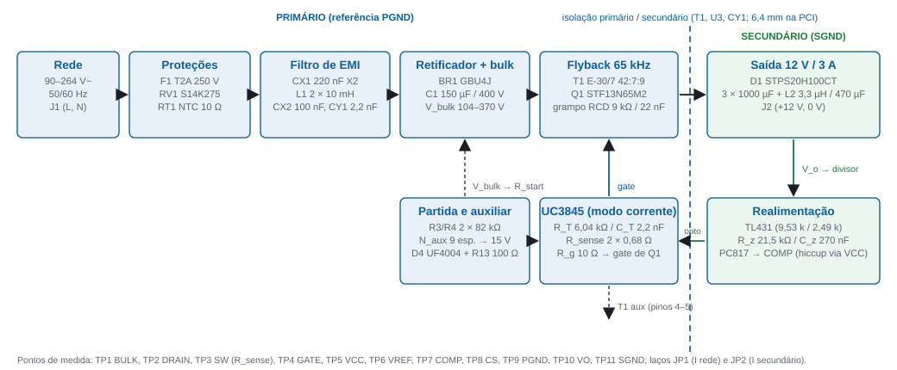

## 2. Fundamentação teórica

### 2.1 Flyback em condução descontínua com controle por corrente de pico

Durante a condução do MOSFET o primário recebe a tensão de *bulk* Vb e a corrente cresce linearmente; no bloqueio a energia armazenada no entreferro é entregue ao secundário pelo diodo. Em **condução descontínua (MCD)** a corrente do secundário zera antes do fim do período, o que elimina a recuperação reversa do diodo e torna a planta de primeira ordem para o controle por corrente de pico (Aula 04C, método de Barbi):

Ip = Vb·D·T / Lp &nbsp;&nbsp;&nbsp; W = ½·Lp·Ip² &nbsp;&nbsp;&nbsp; Po = η·W·fs

Ip = 2·Po / (η·Vb,mín·Dmáx) &nbsp;&nbsp;&nbsp; Lp = Vb,mín·Dmáx / (Ip·fs) &nbsp;&nbsp;&nbsp; Vr = Dmáx/(1−Dmáx)·Vb,mín &nbsp;&nbsp;&nbsp; n = Vr/(Vo+Vf)

No controle por **corrente de pico** o comparador do UC3845 encerra cada ciclo quando a tensão no resistor de sensoriamento atinge o limiar (VCOMP − 1,4)/3 ≤ 1 V: o limite de corrente é inerente, **mas só enquanto o núcleo é reiniciado a cada ciclo**. Com a saída em curto a tensão refletida cai a poucos volts, a corrente magnetizante não se extingue no bloqueio e cresce a cada ciclo pelo tempo mínimo de condução do CI até que as quedas resistivas do secundário forneçam o *reset*. É esse o mecanismo do transitório observado no curto e a razão de a proteção precisar de um segundo nível (desligamento por UVLO).

### 2.2 Estágio de entrada, proteções e qualidade de energia

A ponte com filtro capacitivo conduz perto do pico da rede (Aula 06): corrente pulsada, fator de potência 0,4–0,6 e THD elevada, aceitáveis para 36 W (abaixo dos 75 W da IEC 61000-3-2 classe D). O capacitor de *bulk* define a tensão mínima no vale e as correntes eficazes nos diodos e nele próprio. Proteções (Aula 07): fusível de ação lenta dimensionado em 2 a 3 vezes a corrente eficaz máxima; NTC para o *inrush*; varistor 275 V~; grampo RCD no MOSFET. Filtro de EMI (Aula 08): capacitor X2 (modo diferencial), choke de modo comum dimensionado para a corrente eficaz de entrada e capacitor Y1 entre os terras.

### 2.3 Transformador em alta frequência (Aula 04C)

AeAw = 1,1·Po·10⁴ / (kw·kp·J·fs·Bmáx) &nbsp;&nbsp;&nbsp; lg = 2·µ0·W / (Bmáx²·Ae) &nbsp;&nbsp;&nbsp; Np = Bmáx·lg / (µ0·Ip)

Δ = 7,5/√fs (cm) &nbsp;&nbsp;&nbsp; Sfio = Irms/J &nbsp;&nbsp;&nbsp; ΔT = (Pnúcleo+Pcobre)·Rt, Rt = 23·(AeAw)−0,37 &nbsp;&nbsp;&nbsp; Kocup = Aw,nec/Aw ≤ 0,7

O núcleo com entreferro satura em Isat ≈ Ip·Bsat/Bmáx (≈ 3 A para Bsat = 0,35 T), o que limita na prática o transitório de curto; o modelo de simulação usa indutores lineares e portanto **não** representa a saturação.

### 2.4 Perdas e dissipadores (Aula 02)

Pcond = RDS(on)(Tj)·Irms² &nbsp;&nbsp;&nbsp; Poff = ½·Vds·Ip·tf,ef·fs &nbsp;&nbsp;&nbsp; Pon = ½·Coss·Vds²·fs (ligação com corrente nula em MCD) &nbsp;&nbsp;&nbsp; Pdiodo = V0·Iméd + Rd·Irms²

RθSA ≤ (Tj − Ta)/P − RθJC − RθCS, com Tj = 125 °C e Ta = 40 °C (mesmas hipóteses das Tarefas 1 e 2)

Em um encapsulamento isolado (TO-220FP) a aleta fica sem tensão, ao custo de RθJC maior; o dissipador é necessário sempre que a temperatura de junção sem ele (RθJA ≈ 62,5 °C/W) ultrapassa a meta.

### 2.5 Comando com o UC3845 (Aula 05)

Oscilador fosc ≈ 1,72/(RT·CT); o flip-flop interno divide por dois (fsw = fosc/2, D ≤ 50 %); comparador de corrente com limiar de 1 V; UVLO 8,4/7,6 V; saída *totem-pole* de 1 A; partida por resistor do *bulk* e alimentação pelo enrolamento auxiliar. **Hiccup:** se o auxiliar não sustenta o VCC (saída em curto), CVCC descarrega com ICC − Istart até o UVLO, o CI desliga, Rstart recarrega até 8,4 V e o CI tenta de novo; o ciclo de trabalho da falha é trun/(trun+trecarga). Para isso o resistor série do auxiliar precisa filtrar os picos de dispersão que, com 10 Ω, mantinham o VCC em 13 V no curto. Malha: TL431 + PC817 com compensador tipo 2; o modelo de pequenos sinais inclui o banco de capacitores com RSE, o pós-filtro L2–C13 e o polo do optoacoplador.

### 2.6 Layout (Aula 08 e IPC-2221)

Fluxo linear da entrada para a saída, agrupamento por função, laços de alta di/dt curtos, trilhas a 45°, terras de sinal e de potência unidos num único ponto, 100 nF junto ao VCC do CI, larguras e isolamentos por corrente e tensão (IPC-2221), isolação primário–secundário ≥ 6,4 mm (IEC 62368-1) com fendas, planos de terra, pontos de teste e regras de manufatura (DFM). Na revisão B as regras passaram a ser **verificáveis**: classes atribuídas a todas as redes e ensaio de cobertura com violações deliberadas numa cópia da placa.

## 3. Materiais e métodos

O projeto foi conduzido como uma cadeia reprodutível de scripts: cada etapa lê os resultados da anterior, de modo que esquemático, netlist, lista de materiais, simulação e relatório descrevem a mesma peça e os mesmos valores (tabela 1).

**Tabela 1 – Cadeia de ferramentas e artefatos.**

| Etapa | Método / referência | Ferramenta e script | Saída | Origem |
|---|---|---|---|---|
| Especificação e entrada | Aulas 03, 06, 07 | `02_Calculos/entrada.py`, `emi.py` | capacitor de *bulk*, proteções, filtro de EMI | [C] |
| Flyback e transformador | Aula 04C (Barbi, 14 passos) | `flyback.py`, `transformador.py` | n, Lp, núcleo, espiras, fios, perdas, ΔT | [C] |
| Capacitores e snubber | Aula 03 (6 critérios), Aula 07 | `saida.py`, `snubber.py` | banco de saída, pós-filtro LC, grampo RCD | [C] |
| Semicondutores | Aulas 02 e 03 (pré-escolha, perdas, dissipador) | `semicondutores.py` (+ Power Stage Designer 5 como contraprova) | MOSFET, diodo, ponte, Tj | [C] |
| CI, driver e malha | Aula 05 | `uc3845.py`, `compensador.py` | RT/CT, Rsense, partida, hiccup, compensador | [C] |
| Simulação | LTspice 26 em lote (23 casos) | `03_Simulacao/gera_netlist.py`, `executa_b.py`, `analisa_*.py`, `plota.py` | `medidas.json`, janelas, figuras | [S] |
| Esquemático e placa | KiCad 10, Aula 08, IPC-2221 | `04_KiCad/gera_sch.py`, `placement.py`, `router.py`, `gera_pcb.py`, `kicad-cli` | ERC, DRC, Gerbers, 3D | [CAD] |
| BOM e custo | distribuidores (out/nov 2026) | `05_BOM_Custo/bom.py` | `BOM.xlsx`, `custo.xlsx` | — |
| Relatório | este documento | `06_Relatorio/gera_tabelas.py`, `preenche_relatorio.py`, `build.py` | HTML autossuficiente e PDF | — |

**Modelo de simulação.** UC3845 comportamental com os parâmetros do datasheet (oscilador 1,72/RTCT, latch com D ≤ 50 %, comparador de 1 V com ganho (VCOMP − 1,4)/3 e atraso de 150 ns, UVLO 8,4/7,6 V, Istart 0,5 mA máximo, ICC 11 mA, zener de 34 V); MOSFET VDMOS do STP13N65M2 (mesmo *die* do STF13N65M2) com Ciss, Rg e Vth do datasheet e RDS(on) na temperatura de junção prevista (0,36 Ω típico a 25 °C × 1,47 para Tj ≈ 72 °C); Schottky, UF4007/UF4004 e ponte com VF, Cj e trr de catálogo; TL431 (2,495 V) e PC817 (CTR 1,0, polo de 10 kHz) comportamentais; transformador linear com Llk = 2 % e RSE dos capacitores de catálogo. Os modelos foram conferidos contra os datasheets em 09/11/2026 e os casos rodados de novo. Casos: regime 90/127/220/264 V × 10/50/100 % (6 ciclos de rede, medição nos 2 últimos); partida a frio em 90 e 264 V (pré-carga de C1 e C5 descarregados com Istart máximo até o UVLO, transferindo tensão de barramento e fase da rede); degraus 50 → 100 % e 100 → 50 % em 90 e 264 V e com CTR = 0,5; curto de 60 a 380 ms em 220 V com janelas de aplicação (2 ms), sustentado e recuperação; tolerância do barramento (C1 = 120 µF); sem grampo; Llk = 3 %.

**Tabela 2 – Hipóteses de projeto.**

| Hipótese | Valor | Justificativa |
|---|---|---|
| Rendimento de projeto, η | 0,82 | conservador para 36 W com grampo RCD (Aula 07); a simulação confirma 82,8–85,3 % |
| Razão cíclica máxima, Dmáx | 0,43 | abaixo dos 0,5 do UC3845 com margem para o atraso do comparador |
| Vale de projeto do barramento, Vb,mín | 94,6 V | valor da revisão A (100 µF), mantido para preservar o transformador; com 150 µF o vale real é 104,1 V (margem extra) |
| Densidade de fluxo, Bmáx | 0,25 T | IP12R: Bsat ≈ 0,35 T a 100 °C; folga para o transitório |
| Densidade de corrente, J; kw; kp | 450 A/cm²; 0,4; 0,3 | valores da Aula 04C para flyback |
| Indutância de dispersão, Llk | 2 % de Lp (verificação a 3 %) | enrolamento intercalado; a medir no transformador real |
| Grampo RCD | Vc = 1,8·Vr | compromisso perda × Vds (fig. 7) |
| Temperaturas | Ta = 40 °C, Tj = 125 °C | mesmas das Tarefas 1 e 2 |

## 4. Resultados

### 4.1 Especificação do produto

A tabela 3 reúne os requisitos: os que vêm do enunciado, os fixados pelo projetista e, para cada um, como foi verificado nesta revisão.

**Tabela 3 – Requisitos e verificação.**

| Requisito | Especificado | Origem do requisito | Verificação | Resultado na revisão B |
|---|---|---|---|---|
| Tensão de entrada | 90–264 V~, 50/60 Hz | enunciado (multi-tensão); 127/220 V validados | cálculo + simulação em 90/127/220/264 V | Vo 12,06–12,06 V em toda a faixa [S] |
| Tensão e corrente de saída | 12,0 V ± 5 %, 0,3–3,0 A (36 W) | escolha do projetista (< 25 V) | simulação 10–100 % de carga | regulação < 0,1 % [S] |
| Ondulação de saída | ≤ 120 mV p-p | prática para fontes de mesa | simulação (chaveamento e ciclos de rede) | ≤ 4,8 mV / ≤ 8,5 mV [S] |
| Frequência de comutação | 65 kHz | compromisso tamanho × perdas; UC3845 D ≤ 0,5 | RT/CT | 64,7 kHz [C] |
| Rendimento | meta 85 % em 220 V | boa prática para 36 W | simulação em plena carga | 85,2 % em 220 V, 82,6–85,2 % na faixa [S] |
| Tensão no MOSFET | ≤ 80 % de 650 V (520 V) em regime; ≤ 600 V em falha | Aula 03 (margem de tensão) | simulação 264 V, Llk 2 e 3 %, curto | 482 V regime, 560 V na aplicação do curto [S] |
| Proteções | fusível, NTC, varistor, limite ciclo a ciclo, **hiccup no curto**, grampo RCD | enunciado (surtos, snubber) + parecer (curto) | cálculo + simulação do curto | desligamento por UVLO em 163 ms [S] |
| Filtro de EMI | X2 + choke MC + X2 + Y1 | enunciado | cálculo (curva ideal) | fDM 43 kHz, fCM 24 kHz [C]; LISN pendente |
| Isolação | transformador + opto; ≥ 6,4 mm na PCI | IEC 62368-1 (reforçada, 250 V) | DRC com classes de rede | 0 violações [CAD] |
| Estabilidade | margem de fase ≥ 45° | Aula 05 | modelo de pequenos sinais + degraus simulados | MF 88° (mín. 86°) [C]; degraus sem oscilação [S] |
| Construção | PTH, 2 camadas, preparada para gabinete | Aula 08, Possibilidade II | DRC, cobertura das regras | 140 × 90 mm, 0 erros [CAD] |

### 4.2 Estágio de entrada: retificador, capacitor de bulk e proteções [C]

O ponto de partida é a potência de entrada e a escolha do capacitor de *bulk*, que fixa o vale da tensão retificada em 90 V~ e, com ele, a razão cíclica máxima do flyback.

Memória de cálculo 1 – potência de entrada e capacitor de bulk entrada.py

Pin = Po/η = 36/0,82 = 43,9 W

Critério do vale: Vb,mín ≥ 90 V em 90 V~/50 Hz, com margem para −20 % de tolerância do eletrolítico (guia de projeto; a tabela 4 varre os valores comerciais)

Escolha: C1 = 150 µF / 400 V → Vb,mín = 104,1 V, ondulação 19,9 V, IC,rms = 0,80 A; Vb,máx = 369,6 V em 264 V~ (400 V: 92 % de margem)

Corrente de entrada em 90 V~: Ipico = 2,66 A, Irms = 0,89 A, FP ≈ 0,58, THD ≈ 1 %, condução ≈ 42° por semiciclo

**Tabela 4 – Escolha do capacitor de bulk (90 V~, 50 Hz, plena carga) [C].**

| C | C/Po | Vbulk,mín (V) | Ondulação (V) | IC,rms (A) | FP | THD (%) | Atende 90 V com −20 %? |
|---|---|---|---|---|---|---|---|
| 68 µF | 1,89 µF/W | 80,9 | 43,6 | 0,72 | 0,61 | 104 | não |
| 82 µF | 2,28 µF/W | 88,2 | 36,2 | 0,74 | 0,60 | 112 | não |
| 100 µF | 2,78 µF/W | 94,6 | 29,8 | 0,76 | 0,60 | 119 | só nominal (revisão A) |
| 120 µF | 3,33 µF/W | 99,4 | 24,9 | 0,78 | 0,59 | 126 | limite |
| **150 µF** | 4,17 µF/W | **104,1** | 19,9 | 0,80 | 0,58 | 132 | **sim** (≈ 100 V com −20 %, caso simulado) |

Memória de cálculo 2 – proteções e ponte entrada.py, Aula 07

1

Fusível: If = 2,5·Irms,máx = 2,5 × 0,89 = 2,22 A → T 2 A / 250 V~, 5 × 20 mm, ação lenta (lenta por causa do inrush; em porta-fusível de clipes no protótipo)

2

Inrush em 264 V~: sem limitador 187 A; com NTC 10 Ω frio I = Vpico/(RNTC+Rs) ≈ 31 A → NTC 10 Ω / 2–3 A (abaixo do IFSM da ponte e do fusível)

3

Varistor: Vac,máx = 264 V → MOV 275 V~ (S14K275), Vclamp ≈ 710 V a 50 A &lt; 1000 V do UF4007 e 650 V + grampo do MOSFET

4

Ponte: Iméd/diodo = 0,192 A, Irms = 0,63 A, Ipico = 2,66 A, VRRM ≥ 1,5·Vb,máx = 560 V → GBU4J (4 A / 600 V) (surto de 31 A do inrush pede IFSM ≥ 100 A)

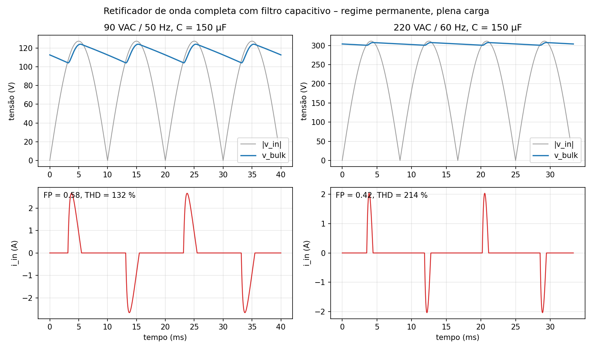

### 4.3 Projeto elétrico do flyback [C]

O projeto preliminar fixa a relação de espiras e a indutância do primário na fronteira MCD/MCC do pior caso (vale de 90 V~, plena carga); os valores finais vêm do transformador construído (§4.4), e com eles recalculam-se os esforços em toda a faixa (tabela 5).

Memória de cálculo 3 – projeto preliminar flyback.py (Aula 04C)

1

Vr = Dmáx/(1−Dmáx)·Vb,mín = 0,43/0,57 × 94,6 = 71,4 V (tensão refletida: soma-se ao bulk no dreno)

2

n = Vr/(Vo+Vf) = 71,4/(12,0+0,7) = 5,62 → adotado n = 6,00 (42:7)

3

Ip = 2·Po/(η·Vb,mín·Dmáx) = 2 × 36/(0,82 × 94,6 × 0,43) = 2,159 A

4

Lp = Vb,mín·Dmáx/(Ip·fs) = 94,6 × 0,43/(2,159 × 65 000) = 289,9 µH; energia por ciclo W = Po/(η·fs) = 675 µJ

5

Com o transformador real (Lp = 293,8 µH, n = 6,00): Vr = 76,2 V, Ip = 2,14 A, D = 0,393 em 90 V~ (vale de 104,1 V) → MCD em todos os pontos; ton,mín = 549 ns em 264 V / 10 % (UC3845: &gt; 350 ns)

6

Esforços: Vds = Vb,máx + 1,8·Vr = 369,6 + 137 ≈ 507 V (78 % de 650 V); Vrev,D1 = Vo + Vb,máx/n = 74 V; Is,pk = n·Ip = 12,9 A; Is,rms = 5,45 A; IC,rms = 4,54 A

**Tabela 5 – Esforços teóricos por ponto de operação (correntes no vale de Vbulk, tensões no pico) [C].**

| Vac | carga | D | Ip (A) | Ip,rms (A) | Is,pk (A) | Is,rms (A) | Ic,rms (A) | Vds grampo (V) | Vd,rev (V) |
|---|---|---|---|---|---|---|---|---|---|
| 90 | 100 % | 0,393 | 2,14 | 0,776 | 12,9 | 5,45 | 4,54 | 261 | 33 |
| 127 | 100 % | 0,253 | 2,14 | 0,623 | 12,9 | 5,45 | 4,54 | 313 | 41 |
| 220 | 100 % | 0,137 | 2,14 | 0,458 | 12,9 | 5,45 | 4,54 | 445 | 63 |
| 264 | 100 % | 0,113 | 2,14 | 0,416 | 12,9 | 5,45 | 4,54 | 507 | 74 |
| 264 | 10 % | 0,036 | 0,68 | 0,074 | 4,1 | 0,97 | 0,92 | 507 | 74 |

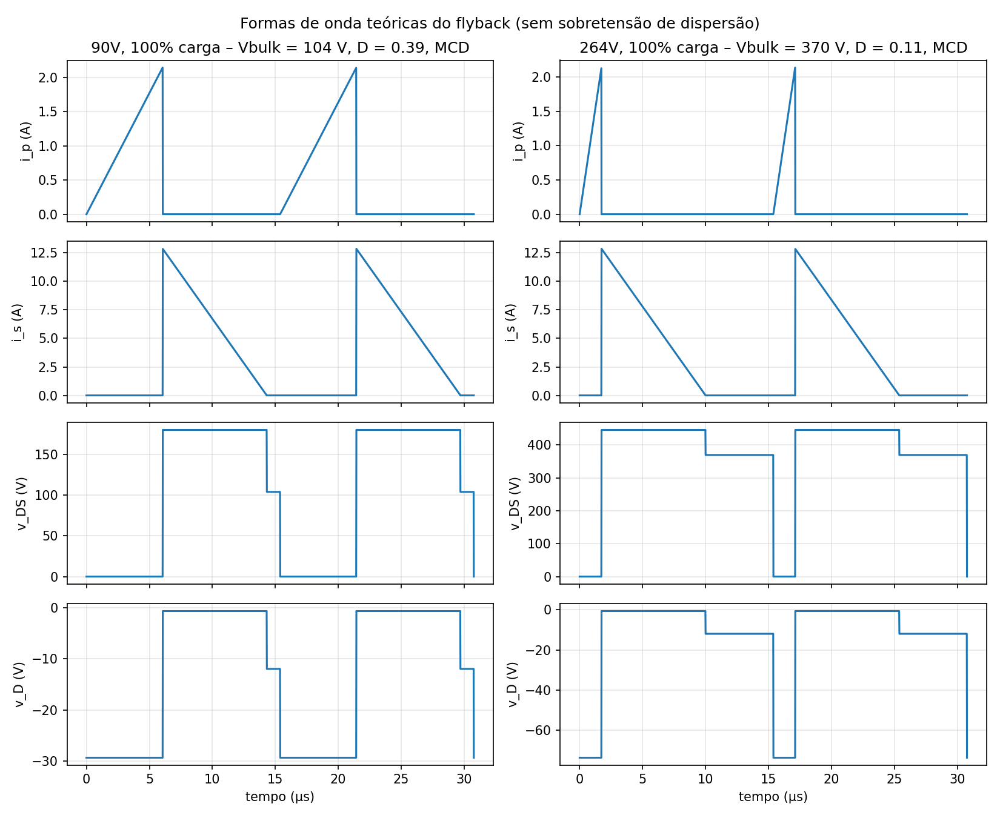

### 4.4 Projeto físico do transformador [C]

O transformador usa **núcleo E de ferrite** (Thornton NEE-30/15/7, material IP12R, dois meios-núcleos com entreferro na perna central e carretel de 10 pinos), a opção da Aula 04C para flyback: a ferrite tem baixas perdas em 65 kHz e o entreferro armazena a energia de cada ciclo. Seguem-se os passos da aula: produto de áreas, escolha do núcleo entre os E de ferrite Thornton disponíveis, entreferro, espiras, bitolas (efeito pelicular), perdas, elevação de temperatura e ocupação da janela.

Memória de cálculo 4 – transformador E-30/7 transformador.py (Aula 04C)

1

AeAw ≥ 1,1·Po·10⁴/(kw·kp·J·fs·Bmáx) = 1,1 × 36 × 10⁴/(0,4 × 0,3 × 450 × 65 000 × 0,25) = 0,451 cm⁴ → E-30/7 (Ae = 0,60 cm², Aw = 0,80 cm², AeAw = 0,48 cm⁴) (menor núcleo que atende; tabela 6)

2

lg = 2·µ0·W/(Bmáx²·Ae) = 2 × 4π·10⁻⁷ × 675·10⁻⁶/(0,25² × 0,60·10⁻⁴) = 0,45 mm (espaçador de 0,23 mm em cada perna externa)

3

Np = Bmáx·lg/(µ0·Ip) = 0,25 × 0,45·10⁻³/(4π·10⁻⁷ × 2,159) = 42 espiras; Ns = Np/n = 7; Naux = Ns·Vaux/(Vo+Vf) = 9 (Vaux ≈ 15,4 V)

4

Lp = µ0·Np²·Ae/lg = 293,8 µH; Ip real = 2,144 A (D = 0,433); Bpico = 0,25 T

5

Δ = 7,5/√65 000 = 0,0294 cm → dmáx = 2Δ = 0,0588 cm → fio ≤ 23 AWG; primário Irms = 0,814 A → 1 × 23 AWG; secundário Irms = 5,45 A → 5 × 23 AWG; auxiliar 1 × 28 AWG (J = 450 A/cm²)

6

Rp = 210 mΩ, Rs = 0,34 mΩ (100 °C); Pnúcleo = 0,62 W + Pcobre = 0,35 W = 0,96 W; Rt = 23·(AeAw)−0,37 = 6,04 °C/W → ΔT = 29,1 °C

7

Aw,nec = 0,368 cm² → Kocup = 0,368/0,80 = 0,46 ≤ 0,7 ✓; Llk estimada (3 %) = 8,8 µH (entrada do snubber)

**Tabela 6 – Núcleos E de ferrite Thornton (IP12R) candidatos, Lp ≈ 294 µH e B = 0,25 T [C].**

| Núcleo | AeAw (cm⁴) | lg (mm) | Np/Ns/Naux | Lp (µH) | P núcleo (W) | P cobre (W) | ΔT (°C) | Kocup | Atende |
|---|---|---|---|---|---|---|---|---|---|
| **E-30/7** | 0,48 | 0,45 | 42/7/9 | 294 | 0,62 | 0,35 | 29,1 | 0,46 | sim |
| E-30/14 | 1,02 | 0,23 | 21/3/4 | 294 | 1,23 | 0,19 | 32,4 | 0,22 | sim |
| E-42/15 | 2,84 | 0,15 | 14/2/3 | 297 | 2,63 | 0,16 | 43,7 | 0,08 | não |

A ficha de fabricação (pinagem 1-BULK, 3-DRAIN, 4-PGND, 5-AUX, 6/7-SGND, 9/10-ânodos de D1, pinos 2 e 8 livres; ordem de camadas com metade do primário por fora; ensaios de Lp, Llk, relação e fase) está no guia de montagem, §3. A sensibilidade ao Bmáx (0,20–0,30 T) está na figura 4: 0,25 T equilibra perdas no núcleo e no cobre com ΔT ≈ 29 °C.

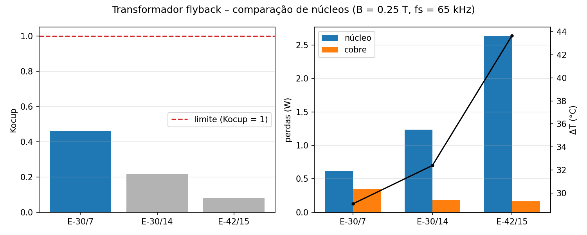

### 4.5 Capacitores e filtro de saída [C]

Os seis critérios da Aula 03 (capacitância mínima, RSE, corrente eficaz, tensão, temperatura e custo) levam a um banco de eletrolíticos de baixa impedância em paralelo, complementado por um pós-filtro LC para atingir a ondulação especificada.

Memória de cálculo 5 – banco de saída e pós-filtro saida.py (Aula 03)

1

Cmín = Io·(1−D2)·T/ΔVC = 3 × (1−0,537) × 15,4 µs/50 mV = 427 µF

2

RSEmáx = ΔVo/Is,pk = 120 mV/12,9 A = 5,4 mΩ (impraticável com um só eletrolítico → banco em paralelo + LC)

3

IC,rms = 4,54 A (catálogo a 105 °C/100 kHz); tensão ≥ 1,5–2·Vo → 25 V; 105 °C, ≥ 5 000 h

4

Escolha: 3 × Rubycon ZLH 1000µF/25V (10x20) → RSEeq = 6,3 mΩ, Iripple = 6,0 A ≥ 4,54 A ✓, ΔV1 = 89 mV (tabela 7)

5

Pós-filtro L = 3,3 µH, C = 470 µF (RSE 40 mΩ): fc = 1/(2π√LC) = 4,0 kHz, atenuação em 65 kHz ≈ 30 dB → ΔVo ≈ 2,7 mV (meta 120 mV) (a ressonância de 4 kHz entra no modelo da malha, §4.9)

**Tabela 7 – Candidatos para o banco de saída [C].**

| Capacitor × n | RSE eq. (mΩ) | Iripple (A) | ΔV1 (mV) | PRSE (W) | Iripple ≥ 4,54 A |
|---|---|---|---|---|---|
| Rubycon ZLH 1000µF/25V (10x20) x2 | 9,5 | 4,0 | 133 | 0,20 | não |
| Rubycon ZLH 1000µF/25V (10x20) x3 | 6,3 | 6,0 | 89 | 0,13 | sim |
| Nichicon UPW 1000µF/25V (10x20) x2 | 15,0 | 3,3 | 204 | 0,31 | não |
| Nichicon UPW 1000µF/25V (10x20) x3 | 10,0 | 5,0 | 136 | 0,21 | sim |
| Rubycon ZLH 1500µF/25V (12.5x20) x2 | 7,5 | 5,1 | 104 | 0,15 | sim |
| Rubycon ZLH 1500µF/25V (12.5x20) x3 | 5,0 | 7,6 | 69 | 0,10 | sim |

Demais capacitores: *bulk* 150 µF/400 V 105 °C (Nichicon UCY2G151MHD); VCC 220 µF/35 V + 100 nF cerâmico junto ao pino; VREF 1 µF; CT 2,2 nF C0G; X2 220 nF e 100 nF; Y1 2,2 nF (passo 10 mm); snubber 22 nF/630 V de filme.

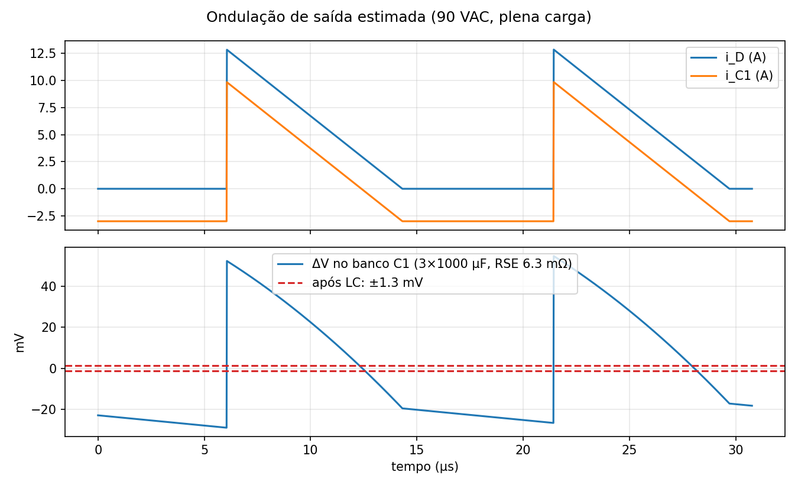

### 4.6 Grampo RCD e amortecimento do diodo [C]

A energia da indutância de dispersão a cada bloqueio precisa ser absorvida: o grampo RCD fixa a tensão de grampo Vc acima da refletida e dissipa essa energia no resistor. Quanto menor Vc, menor a tensão no dreno e maior a perda; adotou-se Vc = 1,8·Vr.

Memória de cálculo 6 – snubber RCD snubber.py (Aula 07)

1

Vc = 1,8·Vr = 1,8 × 76,2 = 137 V; Llk = 2 % de Lp = 5,9 µH

2

Eciclo = ½·Llk·Ip²·Vc/(Vc−Vr) = 13,5 µJ → P = E·fs = 2,02 W (2 %) a 2,62 W (3 %)

3

R = Vc²/P = 9,5 kΩ → 2 × 18 kΩ / 2 W em paralelo = 9 kΩ (em paralelo na placa e no modelo, item 02 do parecer; 4 W nominais para 2–2,6 W)

4

C ≥ 10·τ/R com τ = Ts → Cmín = 16,2 nF → 22 nF / 630 V; tgrampo ≈ 207 ns por ciclo; diodo UF4007 (1 A, 1000 V, trr 75 ns)

5

Resultado: Vc real = 135 V (2 %) / 153 V (3 %) → Vds,máx = 507 / 523 V (≤ 520 V em 264 V~ ✓). TVS P6KE180A levaria a 616 V: não adotado

6

RC do diodo de saída: Llk refletida ≈ 163 nH, Cj ≈ 800 pF → fring ≈ 14 MHz; R = √(L/C) ≈ 14 Ω → 15 Ω; C ≈ 3·Cj → 2,2 nF / 100 V; P ≈ C·V²·fs = 0,85 W → ½ W

**Tabela 8 – Compromisso do grampo com a dispersão [C].**

| Llk | E/ciclo (µJ) | P (W) | R (kΩ) | C mín (nF) | t grampo (ns) | Vds máx (V) |
|---|---|---|---|---|---|---|
| 1% (2,9 µH) | 6,8 | 0,99 | 19,0 | 8,1 | 103 | 507 |
| 2% (5,9 µH) | 13,5 | 1,98 | 9,5 | 16,2 | 207 | 507 |
| 3% (8,8 µH) | 20,3 | 2,96 | 6,3 | 24,2 | 310 | 507 |

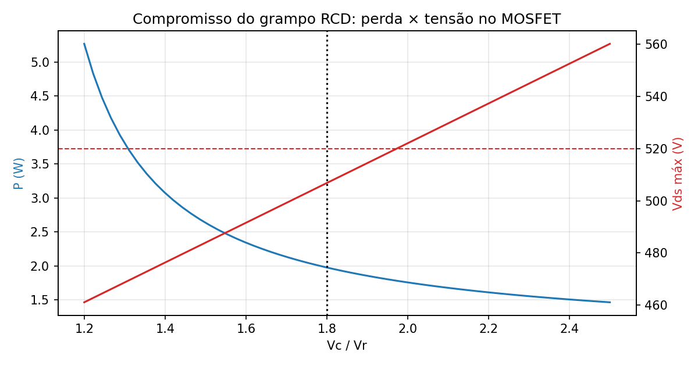

### 4.7 Semicondutores: pré-escolha, perdas e dissipadores [C]

A pré-escolha segue a Aula 03 (tensão de bloqueio com margem, corrente de pico e média no pior caso); as perdas e os dissipadores seguem a Aula 02 e o mesmo método das Tarefas 1 e 2, com contraprova no Power Stage Designer 5.

Memória de cálculo 7 – MOSFET STF13N65M2 semicondutores.py (Aulas 02 e 03)

1

Pré-escolha: Vds,máx = 507 V → classe 650 V (78 % ≤ 80 %); Ip = 2,14 A, Ip,rms = 0,776 A → ID ≥ 4 A; TO-220 para dissipador

2

Condução (264 V~): RDS(on)(125 °C) = 860 mΩ → Pcond = R·Irms² = 0,15 W (0,52 W em 90 V~, pior condução)

3

Comutação (264 V~): tf,ef = Qgd/Ig,off = 24 ns → Poff = ½·V·Ip·tf·fs = 0,86 W; Pon (Coss) = 0,12 W; Pgate = Qg·Vg·fs = 0,014 W

4

Ptotal = 1,15 W (264 V~) / 0,98 W (90 V~). Sem dissipador: Tj = 40 + 1,15 × 62,5 = 112 °C → dissipador necessário

5

RθSA ≤ (125−40)/1,15 − 3,50 = 70 °C/W → clip Aavid 574502B00000G (24 °C/W) → Tj = 40 + 1,15 × (3,50 + 24) = 72 °C (TO-220FP isolado: sem mica, aleta sem o potencial do dreno de ≈ 500 V)

**Tabela 9 – MOSFETs candidatos (650 V) [C].**

| MOSFET | RDS(on) 25 °C (mΩ) | Ptot 90 V (W) | Ptot 264 V (W) | RθJC (°C/W) | isolado | Tj com clip (°C) |
|---|---|---|---|---|---|---|
| IPA65R400CE (Infineon CoolMOS CE, TO-220FP) | 400 | 1,09 | 1,38 | 4,00 | sim | 79 |
| STP13N65M2 (ST MDmesh M2, TO-220) | 430 | 0,98 | 1,15 | 1,14 | não | 69 |
| **STF13N65M2** (ST MDmesh M2, TO-220FP isolado) | 430 | 0,98 | 1,15 | 3,50 | sim | 72 |
| FCPF190N65S3 (onsemi SuperFET III, TO-220F) | 190 | 0,81 | 1,40 | 3,50 | sim | 79 |

Memória de cálculo 8 – diodo de saída e ponte semicondutores.py

1

Pré-escolha: Vrev = 74 V → Schottky 100 V (74 %); Is,pk = 12,9 A, Iméd = 3 A, Irms = 5,45 A → ≥ 10 A; Schottky: sem recuperação reversa (Aula 02)

2

STPS20H100CT (2 × 10 A em paralelo): P = V0·Iméd + Rd·Irms² = 0,55 × 3 + 4,5·10⁻³ × 5,45² = 1,78 W; RθSA ≤ 46,7 °C/W → clip 24 °C/W → Tj ≈ 84 °C (sem dissipador ≈ 150 °C: necessário)

3

Ponte GBU4J: P ≈ 4·(V0·Iméd + Rd·Irms²) = 0,67 W → Tj ≈ 53 °C com RθJA ≈ 20 °C/W → sem dissipador (em produto, parafusar ao gabinete pelo furo)

**Tabela 10 – Orçamento de perdas em plena carga (W) e rendimento estimado [C].**

| Vac | MOSFET | diodo | ponte | trafo | snubber | Rsense | partida | cap. saída | NTC | LLC | UC3845 | total | η (%) |
|---|---|---|---|---|---|---|---|---|---|---|---|---|---|
| 90 | 0,98 | 1,78 | 0,67 | 0,95 | 2,02 | 0,20 | 0,09 | 0,13 | 0,79 | 0,09 | 0,22 | 7,94 | 81,9 |
| 127 | 0,98 | 1,78 | 0,45 | 0,90 | 2,02 | 0,13 | 0,19 | 0,13 | 0,48 | 0,09 | 0,22 | 7,39 | 83,0 |
| 220 | 1,15 | 1,78 | 0,24 | 0,87 | 2,02 | 0,07 | 0,58 | 0,13 | 0,23 | 0,09 | 0,22 | 7,39 | 83,0 |
| 264 | 1,15 | 1,78 | 0,20 | 0,86 | 2,02 | 0,06 | 0,83 | 0,13 | 0,18 | 0,09 | 0,22 | 7,53 | 82,7 |

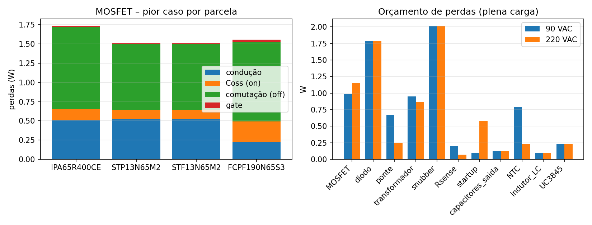

### 4.8 Componentes do UC3845, partida, driver e proteção de curto [C]

Memória de cálculo 9 – oscilador, sensor de corrente e partida uc3845.py (Aula 05, datasheet SLUS223H)

1

Oscilador: fosc = 2·fsw = 130 kHz ≈ 1,72/(RT·CT) → CT = 2,2 nF (C0G) e RT = 6,04 kΩ (E96) → fosc = 129,4 kHz, fsw = 64,7 kHz; tempo morto 424 ns

2

Sensor: limite = 1,25·Ip = 2,68 A → Rs = 0,9 V/2,68 = 0,336 Ω → 2 × 0,68 Ω / 1 W = 0,34 Ω → Ilim = 2,65 A (Vth 0,9 V) a 2,94 A (1,0 V); P = Irms²·Rs = 0,20 W

3

Filtro do ISENSE no pino 3: R = 330 Ω, C = 100 pF → τ = 33 ns ≪ ton,mín/2 = 549/2 ns ✓ (item 03 do parecer: o filtro fica depois do Rsense, junto ao CI)

4

Partida: Rstart = 2 × 82 kΩ / 1 W = 164 kΩ do bulk ao VCC → Istart no vale de 90 V~ = 0,58 mA ≥ 0,5 mA (máx. do CI) ✓; CVCC = 220 µF sustenta 9,2 ms entre 8,4 e 7,6 V (o auxiliar assume em &lt; 6 ms [S])

5

Auxiliar: Naux/Ns = 9/7 → Vaux ≈ 15,4 V (&lt; 30 V do zener interno); UF4004 + R13 = 100 Ω (revisão B: filtra o pico de dispersão para que, no curto, o VCC caia)

6

Driver: saída totem-pole de ±1 A do próprio CI (Qg = 17 nC) → Rg = 10 Ω + 1N4148 antiparalelo + 10 kΩ gate–source. Compensação de rampa: MCD e D &lt; 0,5 → não necessária (m2 = 88,2 mV/µs; provisão R ≈ 1,6 kΩ)

**Tabela 11 – Tempo de partida por resistor (ICC,start típico 0,3 mA) [C]; a simulação com o máximo de 0,5 mA dá 7,3 s em 90 V~ e 1,1 s em 264 V~ [S].**

| Vac | Vbulk pico (V) | I em Rstart (mA) | I líquida para CVCC (mA) | t até o UVLO (s) | P em Rstart (W) |
|---|---|---|---|---|---|
| 90 | 124 | 0,73 | 0,43 | 4,3 | 0,09 |
| 127 | 176 | 1,05 | 0,75 | 2,5 | 0,19 |
| 220 | 307 | 1,85 | 1,55 | 1,2 | 0,58 |
| 264 | 370 | 2,23 | 1,93 | 1,0 | 0,83 |

<b>Partida lenta em rede baixa.</b> Com o Istart máximo do CI a partida em 90 V~ leva 7,3 s — aceitável para fonte de mesa, mas um produto pediria 2 × 68 kΩ (mais dissipação em 264 V~) ou partida ativa. Documentado como limitação da revisão B.

Memória de cálculo 10 – proteção de curto-circuito por hiccup uc3845.py; confirmada por simulação em §4.11

1

Com a saída em curto Vaux ≈ 0,9 V: o auxiliar não alimenta o CI → CVCC descarrega de 15,4 V a 7,6 V com ICC − Istart = 13 − 1,85 mA (220 V~) → tUVLO = C·ΔV/I ≈ 151 ms

2

CI desligado: Rstart recarrega CVCC de 7,6 a 8,4 V → trecarga ≈ 133 ms; religa e roda tligado ≈ 15,5 ms até o VCC cair de novo

3

Ciclo de trabalho da falha = tligado/(tligado+trecarga) ≈ 10,4 % em 220 V~ (tabela 12) → a corrente eficaz média de D1 no curto cai a ≈ √0,13 ≈ 0,37 do valor sustentado (na revisão A, com R13 = 10 Ω, o VCC ficava em 13 V e o curto era sustentado indefinidamente)

**Tabela 12 – Hiccup calculado (CVCC = 220 µF, ICC = 13 mA) [C].**

| Vac | t até UVLO (ms) | t recarga (ms) | t ligado por tentativa (ms) | ciclo de trabalho da falha (%) |
|---|---|---|---|---|
| 90 | 138 | 854 | 14,1 | 1,6 |
| 127 | 141 | 335 | 14,5 | 4,1 |
| 220 | 151 | 133 | 15,5 | 10,4 |
| 264 | 157 | 103 | 16,0 | 13,4 |

### 4.9 Malha de realimentação: TL431 + PC817 e compensador tipo 2 [C]

Memória de cálculo 11 – divisor, planta e compensador compensador.py (Aula 05)

1

Divisor: Rb = 2,49 kΩ, Ra = 9,53 kΩ (1 %) → Vo = 2,495·(1 + Ra/Rb) = 12,04 V; RLED = 2,74 kΩ (ILED ≤ 3 mA), Rbias = 1 kΩ (IKA ≥ 1 mA do TL431)

2

Lado do CI: pull-up Rpu = 4,7 kΩ ao VREF e Cp = 1 nF (polo em 33,9 kHz); CTR = 1,0 nominal (faixa 0,5–1,6 verificada)

3

Planta (controle → saída, modo corrente em MCD): G0 = 15,6 dB e fp = 26,5 Hz em plena carga (25,6 dB e 2,7 Hz a 10 %); zero da RSE em 8,4 kHz; pós-filtro L2–C13 ressonante em 4 kHz; polo do opto em 10 kHz (item 08 do parecer: modelo completo)

4

Compensador tipo 2 com zero sobre o polo da planta e fc alvo = 0,8 kHz: |Gvc(fc)| = −14,9 dB → Rz/Ra = 2,26 → Rz = 21,5 kΩ, Cz = 270 nF (fz = 27 Hz)

5

Resultado: fc = 0,79 kHz, margem de fase 88°, margem de ganho 13 dB em plena carga; mínimo de 86° entre 10 % de carga e CTR de 0,5 a 1,6 (tabela 13) (a margem é resultado do modelo; os degraus simulados confirmam a ausência de oscilação, mas não a medem)

**Tabela 13 – Margens de estabilidade do modelo [C].**

| Condição | fc (kHz) | Margem de fase (°) | Margem de ganho (dB) |
|---|---|---|---|
| carga 100 %, CTR 1.0 | 0,79 | 88 | 13 |
| carga 10 %, CTR 1.0 | 0,25 | 86 | 23 |
| carga 100 %, CTR 1.6 | 1,35 | 86 | 9 |
| carga 100 %, CTR 0.5 | 0,39 | 90 | 19 |

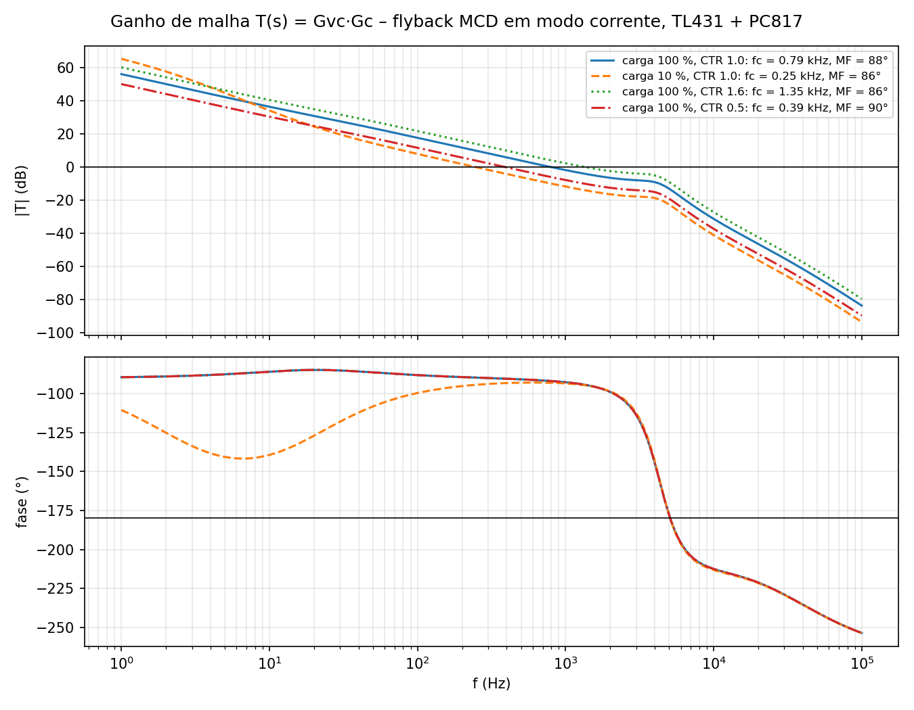

### 4.10 Filtro de EMI [C]

Memória de cálculo 12 – filtro de entrada emi.py (Aula 08)

1

Choke de modo comum LCM = 10 mH por enrolamento, dispersão ≈ 200 µH (modo diferencial), corrente ≥ Irms em 90 V~ = 0,89 A → Schaffner RN214-1.2-02-10M (1,2 A a 40 °C) (item 04 do parecer: o choke da A era de 0,7 A)

2

Modo diferencial (Llk + X2 220 nF ∥ 100 nF): fDM = 1/(2π√(Llk·CX)) ≈ 43 kHz → atenuação ≥ 58 dB em 195 kHz (3ª harmônica, primeira dentro da faixa CISPR)

3

Modo comum (LCM + CY 2,2 nF): fCM ≈ 24 kHz → 26 dB em 150 kHz; corrente de fuga a 250 V/60 Hz = 0,21 mA &lt; 0,25 mA (classe II) ✓

4

Descarga do X2: 2 × 470 kΩ = 1 MΩ → 34 V em 0,77 s (&lt; 1 s) ✓. A curva é ideal: a medição com LISN fica para o protótipo

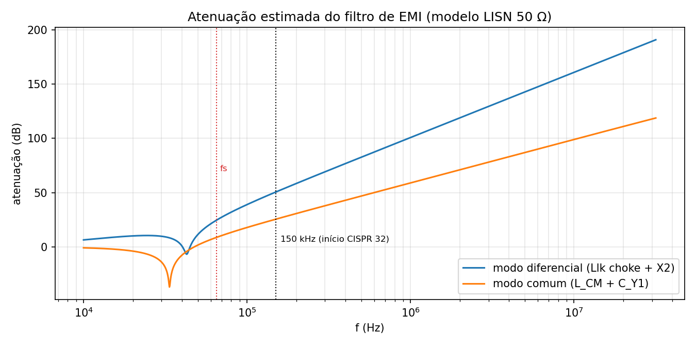

### 4.11 Simulação da revisão B e comparação com a teoria [S]

A simulação cobre os 23 casos da tabela 14; cada caso tem um objetivo e uma janela de medição definidos antes de rodar, e as grandezas são extraídas automaticamente (`.meas` do LTspice e releitura dos `.raw`).

**Tabela 14 – Casos simulados e o que cada um verifica.**

| Grupo | Casos | O que verifica | Janela de medição |
|---|---|---|---|
| Regime permanente | 90/127/220/264 V~ × 10/50/100 % (12) | regulação, ondulação, esforços, perdas e rendimento (teoria × simulação) | 2 últimos de 6 ciclos de rede |
| Partida a frio | 90 e 264 V~ (2) | tempo de partida, VCC mínimo, sobretensão, Ip e Vds na partida | pré-carga até o UVLO + 100 ms |
| Degraus de carga | 50 ↔ 100 % em 90 e 264 V~; CTR = 0,5 (3) | desvio, tempo de retorno, ausência de oscilação | 70–120 ms (degraus em 80 e 100 ms) |
| Curto-circuito | 220 V~, 60–380 ms (1) | aplicação (2 ms), sustentado (hiccup), recuperação | janelas separadas + releitura do .raw |
| Tolerâncias | C1 = 120 µF; sem grampo; Llk = 3 % (3) | vale do barramento; Vds sem snubber; sensibilidade à dispersão | regime, 264 V~ |
| Pré-carga | 90 e 264 V~ (2) | tempo até o UVLO com Istart máximo | até VCC = 8,4 V |

**Regime permanente.** A tabela 15 compara, ponto a ponto, a teoria da §4.3 com a simulação; a ondulação aparece como ondulação de chaveamento (20 períodos) e como excursão total em ciclos inteiros da rede.

**Tabela 15 – Teoria [C] × simulação [S] em regime permanente.**

{{regime}}

**Tabela 16 – Perdas e rendimento em plena carga [C] × [S].**

{{perdas}}

![Figura 10 – Um ciclo de comutação em 90 V~, plena carga: corrente do primário, do secundário e tensão no dreno [S].](assets/regime_90V_100pct_ciclo.png)

![Figura 11 – Comutação em 264 V~, plena carga: o grampo RCD limita o dreno a 482 V [S].](assets/regime_264V_100pct_comut.png)

**Transitórios.** A partida a frio parte de C1 e C5 descarregados: o modelo de pré-carga leva o VCC até o UVLO com o Istart máximo e transfere a tensão de barramento e a fase da rede nesse instante ao modelo de chaveamento. Os degraus são aplicados nos dois sentidos após a estabilização (tabela 17).

**Tabela 17 – Transitórios [S].**

{{transitorios}}

![Figura 12 – Partida a frio em 90 V~: barramento, VCC e saída; Vo atinge 11,4 V em 5,3 ms sem sobretensão [S].](assets/partida_90V_rede.png)

![Figura 13 – Degraus de carga 50 → 100 → 50 % em 90 V~: desvio ≤ 116 mV e retorno a ±0,5 % em ≤ 4,4 ms [S].](assets/degrau_90V_rede.png)

**Curto-circuito (tabela 18, figuras 14 e 15).** O curto é aplicado em 60 ms e mantido até 380 ms. Na **aplicação**, a corrente do primário sobe por alguns ciclos acima do limite — não há *reset* do núcleo com a saída em zero — até 8,0 A (0,94 T no modelo linear; o núcleo real satura em ≈ 3 A, o que encurta o transitório), I(D1) chega a 57 A e Vds a 560 V (margem de falha fixada em 600 V, 92 % de 650 V, para pulsos). No **curto sustentado** a limitação ciclo a ciclo segura Ip em 3,4 A e D1 conduz 13,1 A eficazes com 6,2 W; com R13 = 100 Ω o VCC cai e o CI **desliga por UVLO** (VCC mínimo 7,6 V), religando após a recarga: 163 ms até o primeiro desligamento, 130 ms desligado, 20 ms ligado por tentativa (ciclo de trabalho 14 %; cálculo da §4.8: 151 / 133 / 15,5 ms, 10,4 %). Na **recuperação** o curto é removido (380 ms) com o CI desligado no hiccup: a saída permanece em zero até o próximo cruzamento do UVLO (VCC = 7,90 V no fim dos 40 ms simulados; pela taxa de recarga o religamento ocorre ≈ 123 ms após a remoção do curto) e a sequência seguinte é a partida normal da figura 12, sem sobretensão; o tempo de recuperação é, portanto, no máximo um período de recarga (130 ms em 220 V~).

**Tabela 18 – Curto-circuito em 220 V~ por janelas [S].**

{{curto}}

![Figura 14 – Curto-circuito em 220 V~: janela completa com aplicação, sustentado com hiccup e recuperação [S].](assets/curto_220V_janelas.png)

![Figura 15 – Zoom na aplicação do curto: transitório sem reset do núcleo [S].](assets/curto_220V_aplicacao.png)

![Figura 16 – Dreno sem o grampo RCD em 264 V~: a dispersão levaria Vds acima da classe do MOSFET [S].](assets/sem_snubber_264V_comut.png)

**Análise.** A tensão de saída fica entre 12,06 e 12,06 V em toda a faixa (regulação de linha e carga < 0,1 %). Em plena carga a corrente de pico do primário difere -3,7 % da teoria (limiar efetivo do comparador e atraso do filtro), Is,pk +10,1 %, Is,rms -10,2 % (a teoria integra o triângulo ideal no vale de Vbulk) e Vds -4,9 % em 264 V (grampo real abaixo de 1,8·Vr). Em carga leve a diferença de Vds (grampo mais baixo com menos energia de dispersão) e de Is,pk excede 10 % a favor da segurança: os casos excedidos estão listados na tabela 19 com as hipóteses do cálculo (triângulo ideal no vale de Vbulk, grampo fixo em 1,8·Vr). O rendimento simulado em 220 V~/3 A é 85,2 % (meta 85 %; cálculo 83,0 %), com o grampo (1,33 W) e o diodo (1,72 W) como maiores parcelas — o mesmo que o orçamento de perdas da §4.7 indicava.

**Tabela 19 – Verificação dos critérios de projeto.**

{{criterios}}

### 4.12 Esquemático [CAD]

Esquemático B (figura 17; `04_KiCad/fonte_flyback_12V3A_esquematico.pdf`): ERC **0 erros, 0 avisos** (`erc.json`); 71 itens na netlist (54 componentes elétricos, 2 laços de medida JP1/JP2, 11 pontos de teste, 4 furos), 35 redes; R5 ∥ R6, C3 no pino 3, TL431 K-A-REF, choke 1-2/3-4, R13 100 Ω, Q1 STF13N65M2. Netlist, BOM e desenho do transformador descrevem a mesma ligação (parecer, passo 1).

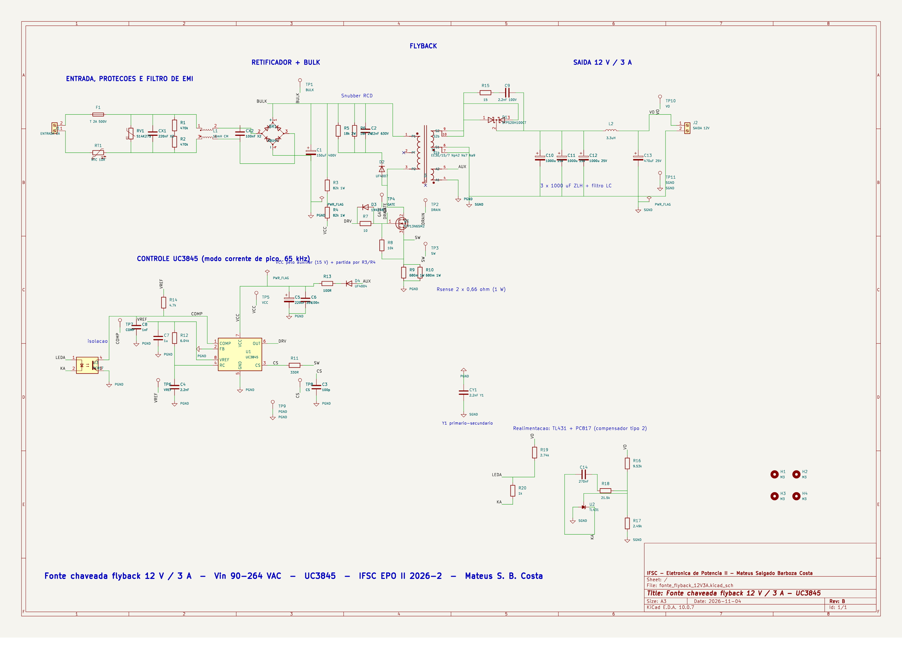

### 4.13 Lista de materiais e custo

A BOM B (`05_BOM_Custo/BOM.xlsx`, 58 itens com part number, fabricante e código de distribuidor) é um orçamento de engenharia: preços herdados da revisão A e provisões para os itens trocados, sem cotação de compra. **US$ 42,73 por fonte com a PCI rateada em 5 placas** (≈ R$ 235) e **US$ 22,37 em 100 unidades**. Para montar um único exemplar comprando o lote mínimo de 5 placas a saída de caixa é ≈ US$ 81 antes de fretes e impostos (parecer, item 11). Em 05/11 o fusível axial soldado deu lugar a fusível 5 × 20 T2A/250 V em clipes (porta-fusível para os ensaios; o axial fica para o produto) e entraram os laços de fio JP1/JP2 para sonda de corrente (Aula 08).

**Tabela 20 – Custo por bloco funcional (1 unidade, PCI rateada).**

| Bloco | Itens | US$ (1 un.) | US$ (100 un.) | % do total |
|---|---|---|---|---|
| PCI (2 camadas, 140x90 mm, FR-4 1,6 mm) | 1 | 9,60 | 1,90 | 22,5 |
| Filtro EMI | 6 | 6,01 | 3,87 | 14,1 |
| Secundario | 10 | 5,05 | 3,14 | 11,8 |
| Transformador | 2 | 4,50 | 3,00 | 10,5 |
| Retificador e bulk | 2 | 3,90 | 2,55 | 9,1 |
| Potencia primaria | 4 | 3,10 | 2,08 | 7,3 |
| Entrada e protecoes | 6 | 3,00 | 1,88 | 7,0 |
| Mecanica | 17 | 2,80 | 1,42 | 6,6 |
| Comando UC3845 | 16 | 2,55 | 1,38 | 6,0 |
| Realimentacao | 10 | 1,21 | 0,61 | 2,8 |
| Snubber RCD | 4 | 1,01 | 0,54 | 2,4 |

### 4.14 Layout da PCI [CAD]

Placa de 140 × 90 mm, 2 camadas, FR-4 1,6 mm, todos os componentes PTH (figuras 18 a 20). O placement foi revisto em 05/11/2026, antes do pedido da PCI, com a análise região a região de `04_KiCad/ANALISE_PLACEMENT.md`. A tabela 21 resume como cada regra da Aula 08 foi atendida e verificada.

**Tabela 21 – Regras de layout e verificação.**

| Regra (Aula 08 / IPC-2221 / IEC 62368-1) | Como foi atendida | Verificação |
|---|---|---|
| Fluxo linear entrada → saída | J1 na borda esquerda abrindo para fora → F1 → JP1 → RV1/RT1 → CX1 → L1 → CX2 → BR1 → C1 → Q1/T1 → D1 → banco → L2 → J2 na borda direita | redes da rede de 80 para 54 mm (`comprimento_redes.txt`) |
| Laços de alta di/dt curtos | dreno de Q1 a 15,7 mm do pino 3 de T1; fonte → R9/R10 → PGND em 7 mm; D1 a 10 mm do banco | `placement.py`, 0 sobreposições |
| Terra de sinal × terra de potência | plano PGND de potência e ilha de sinal do UC3845 unidos só no lado frio do Rsense; ilha contínua (flood-fill) | `router.py` |
| Analógicos junto ao CI, 100 nF no VCC | filtro do ISENSE, RT/CT, VREF e C6 (100 nF a 4,3 mm do pino 7) ao redor de U1 | `placement.py` |
| Larguras por corrente (35 µm) | rede 1,2 mm; bulk 1,5 mm; HV 1,0 mm; secundário de potência 2,0 mm (5,45 A rms, ΔT &lt; 20 °C); sinais 0,5 mm | regras `largura_HV` ≥ 1,0 e `largura_SEC_potencia` ≥ 1,5 no DRC |
| Isolamento HV e primário–secundário | ≥ 1,0 mm entre redes de alta tensão; **≥ 6,4 mm** entre primário e secundário (reforçada, 250 V), fendas de 1,2 mm sob T1 e U3; exceção de 6,0 mm só sob a fenda do opto (DIP-4 de 7,62 mm; a fenda interrompe a linha de fuga) | DRC 0 violações; cópia sem a exceção acusa 8, todas em U3 |
| Sem trilhas a 90° | 255 dobras a 45°; 21 ângulos retos só em saídas de pad | contagem no pcbnew |
| Magnéticos e sensores afastados | L1 a 70 mm de T1, L2 a 30 mm; Rsense a 38 mm | `placement.py` |
| Térmico e gabinete | Q1 (TO-220FP isolado) e D1 com clips de 24 °C/W, Q1 a 6 mm de C1; R5/R6 e NTC afastados dos eletrolíticos; furos M3 a ≥ 8,5 mm das redes da rede; J1 e J2 em faces opostas | `VERIFICACAO_LAYOUT.md` §4 |
| Pontos de medida (protótipo) | 11 TPs com nome na serigrafia + laços JP1 (I da rede) e JP2 (I do secundário) para sonda de corrente | esquemático |
| Serigrafia de segurança | "F1 T2A 250V", "N"/"L", "+12V 3A"/"0V", "C1 400V DESCARREGAR" | DRC sem `silk_over_copper` novo |
| DFM | PTH para solda manual; menor distância entre pads de componentes diferentes 0,95 mm (sinal); porta-fusível de clipes; eletrolíticos com passo 12 mm | script |

**DRC: 0 erros, 0 itens não conectados, 0 divergências com o esquemático**; 3 avisos de serigrafia justificados (corpo do opto sobre a fenda; marca "K" do D3). **Ensaio de cobertura:** numa cópia com cinco violações deliberadas cada regra disparou (`HV_clearance`, `isolacao_prim_sec`, `largura_HV`, `largura_SEC_potencia`, `borda`). Fabricação: `04_KiCad/gerbers/` (Gerbers RS-274X, furação Excellon e mapa, da mesma revisão, inspecionados com as fendas em `imagens/pcb_camadas.pdf`). Pendências para a revisão C de layout, a decidir com as medições do protótipo: aproximar o bloco do UC3845 de Q1 (trilhas /COMP, /CS e gate longas), deitar D1 e levar Q1/D1 à borda com dissipador parafusado.

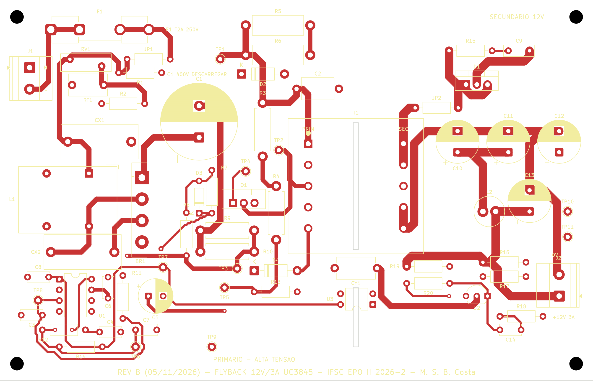

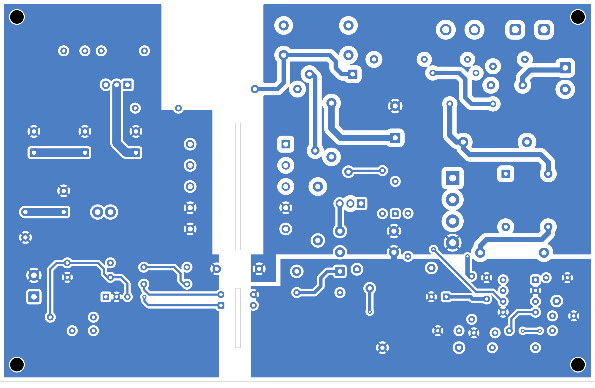

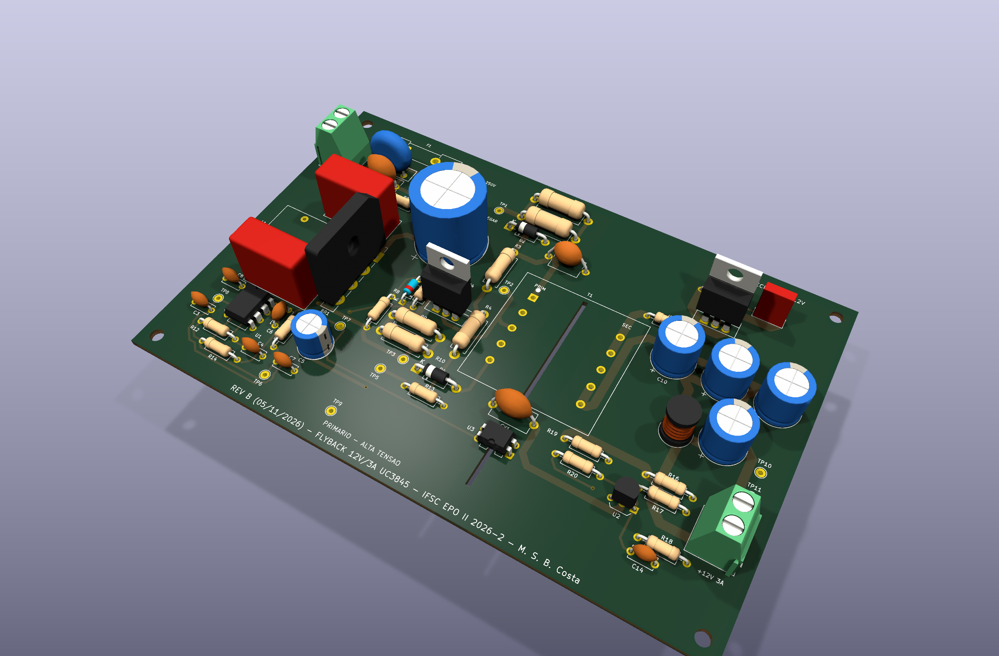

### 4.15 Montagem e ensaio (Possibilidade II em execução)

O guia `08_Montagem/GUIA_MONTAGEM.md` traz a ficha de fabricação de T1 com pinagem única, os ensaios do transformador antes de montar (Lp, Llk, relação e fase), a montagem por blocos com teste de cada um, a instrumentação (transformador isolador, terra de proteção do osciloscópio mantido, sonda diferencial, descarga de C1 com 4,7 kΩ/10 W) e a tabela de aceite com origem C/S/M. O **curto-circuito físico fica bloqueado** até os limites da seção 5.4 do guia (2 s, parada por Ip &gt; 3,5 A ou VCC sem cair). Para a execução: `PEDIDO_COMPRA.md` (58 itens, ≈ US$ 109 com sobressalentes e lote de 5 placas), `CRONOGRAMA.md` (T1 na semana 2, blocos nas semanas 4–5, ensaios na 6, revisão C na 7) e `REGISTRO_MEDICOES.md` com as células [M] em branco. Nenhum resultado experimental existe nesta revisão.

## 5. Conclusão

A revisão B responde ao parecer técnico com uma referência elétrica única (esquemático, netlist, BOM e desenho do transformador descrevendo a mesma peça e ligação), simulações refeitas com janelas antes/durante/depois de cada evento e uma proteção de curto-circuito efetiva: o transitório de aplicação do curto permanece (é inerente ao flyback sem *reset* com saída em zero e fica dentro dos limites pulsados dos semicondutores — 8,0 A e 560 V no modelo, menos no núcleo real por saturação), mas o curto sustentado agora termina em **desligamento por UVLO e hiccup** graças ao resistor de 100 Ω no auxiliar. Em regime a simulação dá Vo = 12,06–12,06 V, ondulação ≤ 4,8 mV, Vds = 482 V em 264 V~ (74 % de 650 V), partida a frio e degraus nos dois sentidos estáveis e rendimento de 85,2 % em 220 V~ — números coerentes com o orçamento de perdas e com os esforços calculados pelo método da Aula 04C, com desvios explicados pelas hipóteses conservadoras do cálculo. A placa tem DRC com classes atribuídas, isolação reforçada de 6,4 mm e cobertura comprovada das regras, dissipadores dimensionados (necessários em Q1 e D1), MOSFET isolado, conectores e distâncias pensados para gabinete e pacote de fabricação da mesma revisão. Permanecem como trabalho da revisão C: medir Llk e a saturação do transformador real, as temperaturas de Q1, D1 e C1, o ruído nas trilhas de controle (TP7/TP8) e as emissões conduzidas, e decidir com esses dados as melhorias de layout já identificadas.

## 6. Referências bibliográficas

1. MOIA, J. *Apresentações das Aulas 01 a 08 – Eletrônica de Potência II*. IFSC, 2026.
2. *Parecer sobre a primeira versão – Tema II, fonte flyback isolada de 12 V e 3 A* (REVISAO_TECNICA_V1.pdf), 04/11/2026.
3. BARBI, I. *Projeto de fontes chaveadas*. Florianópolis: Edição do Autor, 2003.
4. BARBI, I. *Eletrônica de potência*. 5. ed. Florianópolis: Edição do Autor, 2005.
5. ERICKSON, R. W.; MAKSIMOVIĆ, D. *Fundamentals of power electronics*. 2. ed. Kluwer, 2001.
6. MOHAN, N.; UNDELAND, T.; ROBBINS, W. *Power electronics: converters, applications and design*. 2. ed. Wiley, 1995.
7. TEXAS INSTRUMENTS. *UCx84x Current-Mode PWM Controllers* (SLUS223H), 2024; *TL431 / TL432* (SLVS543), tabela 5-1.
8. STMICROELECTRONICS. *STP13N65M2 / STF13N65M2* (DS10587); *STPS20H100CT*; *UC3845B*.
9. SCHAFFNER. *RN series common-mode chokes* (RN214); LITTELFUSE. *215 series 5 × 20 mm ceramic fuses* e *477 series*; KEYSTONE. *3517 fuse clips*; NICHICON. *UCY series*; RUBYCON. *ZLH series*.
10. THORNTON ELETRÔNICA. *Núcleos de ferrite NEE – IP12R*.
11. IPC. *IPC-2221B – Generic Standard on Printed Board Design*, 2012; IEC. *IEC 62368-1* (isolação) e *IEC 60664-1* (coordenação de isolamento).
12. TEKTRONIX. *Fundamentals of floating measurements and isolated input oscilloscopes* (application note).
13. ANALOG DEVICES. *LTspice – Help*; KICAD. *KiCad 10 documentation – kicad-cli, custom design rules*.
14. IFSC. *Plano de Ensino – ELP22109, 2026-2*; *Projeto Semestral 2026-2*; *Tarefa Extra*.
