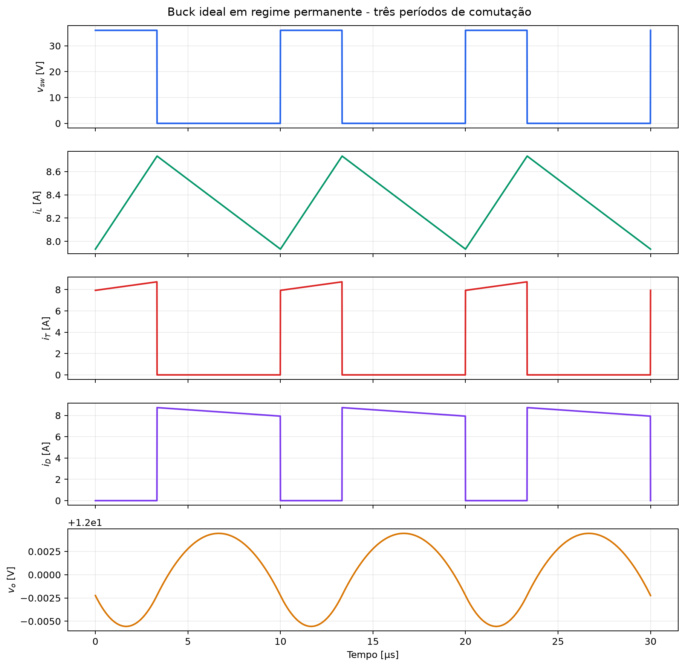
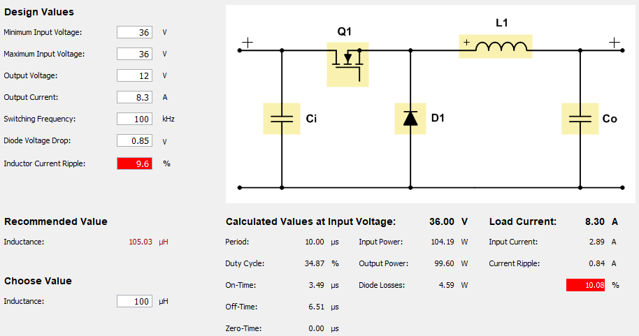
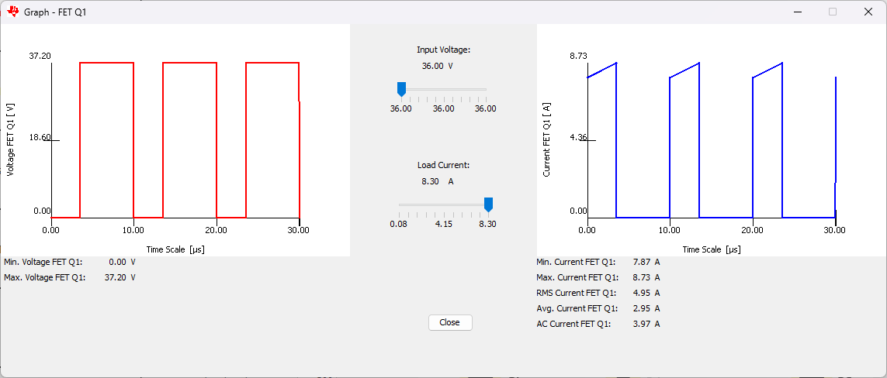
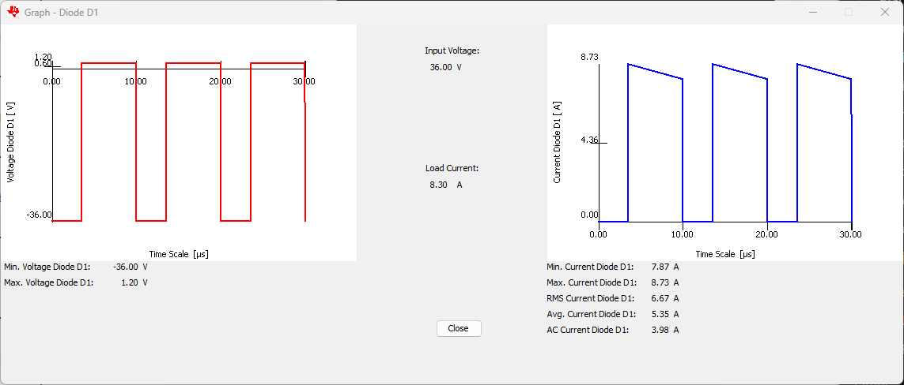
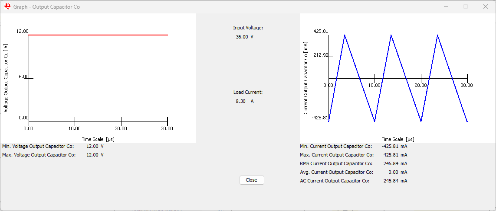
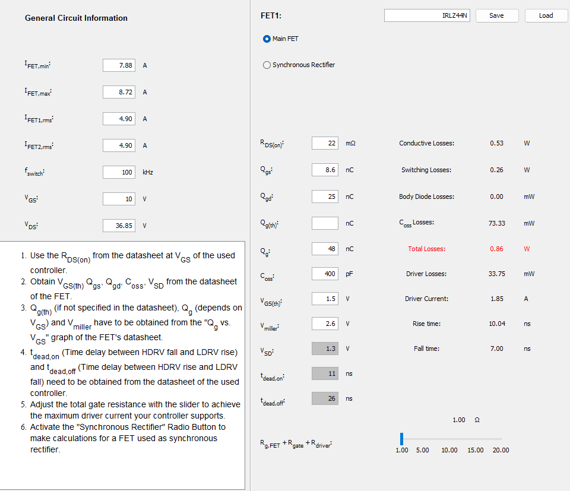
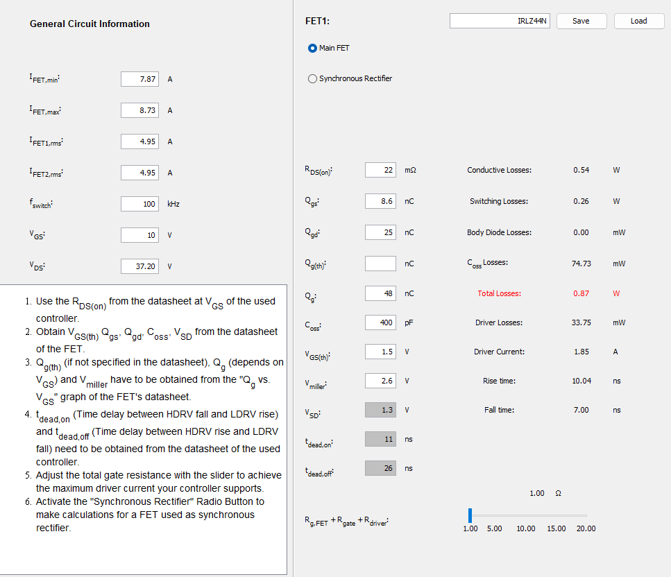
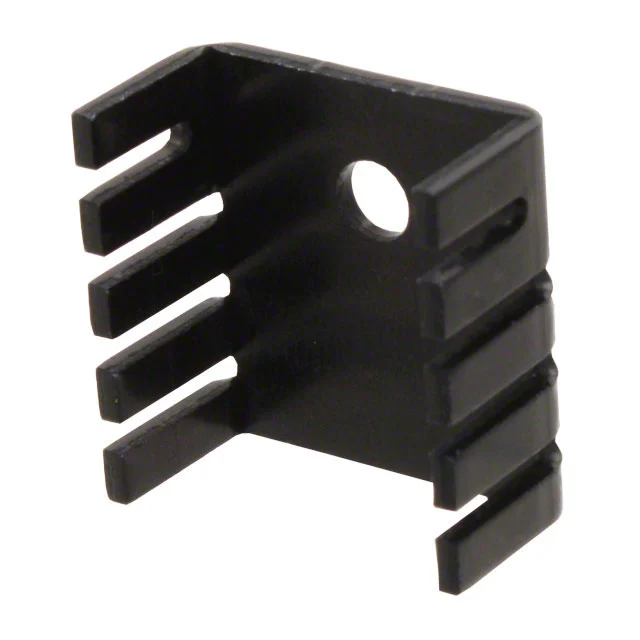
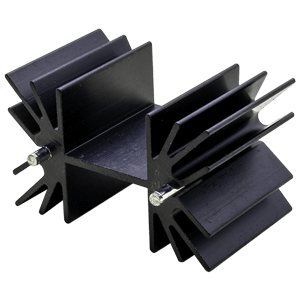
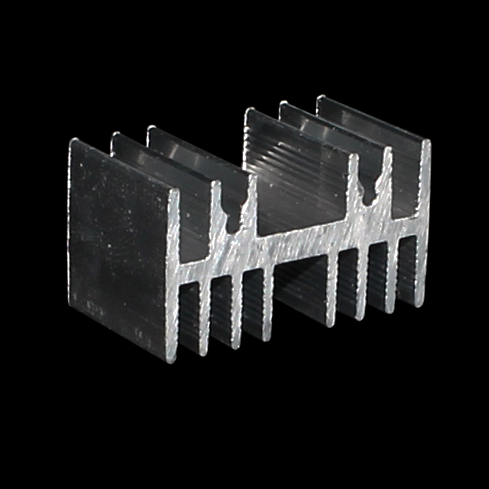

# Tarefa 01 - Cálculo Térmico e Dissipador

**Disciplina:** Eletrônica de Potência II  
**Aluno:** Mateus Salgado Barboza Costa  
**Professor:** Joabel Moia  
**Data:** 24/08/2026

## 1. Objetivo

Analisar o conversor Buck especificado no último slide da aula de 10/08/2026, determinar suas principais formas de onda e os esforços de corrente no transistor e no diodo, estimar as perdas nos semicondutores e dimensionar dissipadores que permitam operação térmica adequada.

## 2. Especificações e hipóteses

| Grandeza | Valor |
|---|---:|
| Tensão de entrada, Vᵢₙ | 36 V |
| Tensão de saída, Vₒ | 12 V |
| Potência de saída, Pₒ | 100 W |
| Frequência, fₛ | 100 kHz |
| Indutância, L | 100 µH |
| Capacitância, C | 100 µF |
| MOSFET | IRLZ44N, TO-220AB |
| Diodos avaliados | MUR860 e MBR20100CT, TO-220 |

Adotou-se regime permanente, modo de condução contínua (MCC), componentes ideais no cálculo das formas de onda e carga puramente resistiva. Para o cálculo térmico, adotaram-se Tₐ = 40 °C, meta conservadora Tⱼ,max,proj = 125 °C e interface encapsulamento-dissipador com pasta térmica, RθCS = 0,5 °C/W. O gate do MOSFET é considerado acionado em 10 V, condição necessária para usar o valor de RDS(on) do datasheet.

## 3. Cálculos elétricos do conversor Buck

### 3.1 Razão cíclica, carga e período

Para o Buck ideal:

$$
D=\frac{V_o}{V_{in}}=\frac{12}{36}=0,3333
$$

$$
T_s=\frac{1}{f_s}=10\ \mu s,\qquad
R_L=\frac{V_o^2}{P_o}=\frac{12^2}{100}=1,44\ \Omega
$$

Assim, tₒₙ = D·Tₛ = 3,333 µs e toff = (1−D)·Tₛ = 6,667 µs.

### 3.2 Corrente de saída e ondulação no indutor

$$
I_o=I_{L,med}=\frac{P_o}{V_o}=\frac{100}{12}=8,333\ A
$$

Durante $t_{on}$, $v_L=V_{in}-V_o=24$ V. A ondulação pico a pico é:

$$
\Delta i_L=\frac{(V_{in}-V_o)D}{L f_s}
=\frac{(36-12)\cdot0,3333}{100\times10^{-6}\cdot100\times10^3}
=0,800\ A
$$

$$
I_{L,min}=8,333-\frac{0,800}{2}=7,933\ A
$$

$$
I_{L,max}=8,333+\frac{0,800}{2}=8,733\ A
$$

Como $I_{L,min}>0$, confirma-se o MCC. A corrente eficaz no indutor é:

$$
I_{L,rms}=\sqrt{I_o^2+\frac{\Delta i_L^2}{12}}=8,337\ A
$$

### 3.3 Ondulação ideal da tensão de saída

Desprezando a ESR do capacitor:

$$
\Delta v_{o,pp}\simeq\frac{\Delta i_L}{8f_sC}
=\frac{0,8}{8\cdot100\times10^3\cdot100\times10^{-6}}
=10,0\ mV
$$

Na prática deve-se somar aproximadamente Δiₗ·ESR a esse valor.

## 4. Principais formas de onda teóricas

| Intervalo | MOSFET | Diodo | vₗ | Inclinação de iₗ |
|---|---|---|---:|---:|
| 0 < t < D·Tₛ | conduz | bloqueado | Vᵢₙ − Vₒ = 24 V | +240 kA/s |
| D·Tₛ < t < Tₛ | bloqueado | conduz | −Vₒ = −12 V | −120 kA/s |

Consequentemente, iₗ é triangular entre 7,933 A e 8,733 A. A corrente do transistor é igual a iₗ durante tₒₙ e zero no restante do período; a corrente do diodo é complementar. A tensão no nó de comutação alterna idealmente entre 36 V e 0 V.

## 5. Validação por Simulação Numérica

### 5.1 Ambiente de simulação

A simulação foi realizada no **Power Stage Designer 5 (PSD5)** da Texas Instruments. O circuito Buck foi modelado com componentes reais:
- **MOSFET:** IRLZ44N com RDS(on) = 22 mΩ, tr = 26 ns, tf = 11 ns
- **Diodo:** MUR860 (Vf = 1,2 V) e MBR20100CT (Vf = 0,85 V) para comparação
- **Componentes passivos:** L = 100 µH, C = 100 µF ideais
- **Carga:** Rl = 1,44 Ω (resistiva pura)

### 5.2 Resultados experimentais vs. teóricos

As figuras abaixo mostram as principais formas de onda medidas na simulação:

*Figura 5.1: Parâmetros de entrada e resultados calculados pelo PSD5 para o Buck com MUR860.*

**Tabela de comparação — Cálculo manual vs. Simulação PSD5:**

| Grandeza | Cálculo | Simulação | Diferença |
|---|---:|---:|---:|
| Razão cíclica D | 33,33% | 35,48% | +6,5% |
| Período Ts | 10,00 µs | 10,00 µs | — |
| Duty cycle On-time | 3,333 µs | 3,55 µs | +6,5% |
| Corrente média saída | 8,333 A | 8,30 A | −0,4% |
| Δiₗ,ₚₚ | 0,800 A | 0,85 A | +6,2% |
| Iₗ,ₘᵢₙ | 7,933 A | 7,87 A | −0,8% |
| Iₗ,ₘₐₓ | 8,733 A | 8,73 A | ~0% |
| Δvₒ,ₚₚ | 10,0 mV | <10 mV | — |
| Vₒ (média) | 12,0 V | 12,0 V | — |

**Observações:** As diferenças surgem porque o PSD5 considera a queda de tensão real do diodo (1,2 V), aumentando o duty cycle para ~35,5%, fenômeno não capturado no modelo ideal. Os esforços de corrente batem com precisão < 1%.

### 5.3 Formas de onda do transistor Q1 (IRLZ44N)

*Figura 5.2: Forma de onda do transistor Q1. Esquerda: tensão VDS (0–37,2 V). Direita: corrente IQ (7,87–8,73 A, triangular).*

**Esforços medidos:**
- Iₜ,ₘᵢₙ = 7,88 A, Iₜ,ₘₐₓ = 8,72 A, Iₜ,ᵣₘₛ = 4,90 A, Iₜ,ₘₑᵈ = 2,95 A
- Vₜ,ₘᵢₙ = 0 V, Vₜ,ₘₐₓ = 37,2 V

### 5.4 Formas de onda do diodo D1 (MUR860)

*Figura 5.3: Forma de onda do diodo D1 (MUR860). Esquerda: tensão reversa (−36 V, bloqueado) e 1,2 V (condução). Direita: corrente complementar ao transistor.*

**Esforços medidos:**
- Iᴅ,ₘᵢₙ = 7,87 A, Iᴅ,ₘₐₓ = 8,73 A, Iᴅ,ᵣₘₛ = 6,67 A, Iᴅ,ₘₑᵈ = 5,35 A
- Vᴅ,ₘᵢₙ (reverso) = −36 V, Vᴅ,ₘₐₓ (condução) = 1,20 V

### 5.5 Tensão de saída

*Figura 5.4: Tensão de saída Vout no capacitor de saída Co. A tensão permanece em 12 V com ondulação não visível nesta escala (~10 mV pico-pico), validando o projeto do filtro.*

### 5.6 Perdas de potência — Comparação MUR860 vs. MBR20100CT

*Figura 5.5: Perdas calculadas pelo PSD5 para o MOSFET IRLZ44N com diodo MUR860 (VF=1,2 V).*

*Figura 5.5: Perdas calculadas pelo PSD5 para o MOSFET IRLZ44N com diodo MBR20100CT (VF=0,85 V).*

**Tabela resumida — Perdas totais na simulação:**

| Componente | MUR860 | MBR20100CT | Diferença |
|---|---:|---:|---:|
| **Q1 (IRLZ44N)** | | | |
| — Conductive | 0,53 W | 0,54 W | +1,9% |
| — Switching | 0,26 W | 0,26 W | — |
| — Coss | 73,3 mW | 74,7 mW | +1,9% |
| — **Total Q1** | **0,86 W** | **0,87 W** | +1,2% |
| **D1 (Diodo)** | | | |
| — **Perdas diodo** | **6,43 W** | **4,59 W** | **−1,84 W (−29%)** |
| **TOTAL do conversor** | **7,29 W** | **5,46 W** | **−1,83 W (−25%)** |

**Conclusão:** O MBR20100CT reduz as perdas totais em **1,83 W** (~25%) comparado ao MUR860, exclusivamente pela queda de tensão direta menor (0,85 V vs 1,2 V).

| Resultado | Simulação | Cálculo teórico |
|---|---:|---:|
| Razão cíclica | 0,3333 | 0,3333 |
| Corrente média de saída | 8,333 A | 8,333 A |
| Δiₗ,ₚₚ | 0,800 A | 0,800 A |
| Iₗ,ₘᵢₙ | 7,933 A | 7,933 A |
| Iₗ,ₘₐₓ | 8,733 A | 8,733 A |
| Δvₒ,ₚₚ sem ESR | 10,0 mV | 10,0 mV |

## 6. Esforços de corrente e tensão

Considerando a ondulação triangular:

$$
I_{T,med}=DI_o=2,778\ A
$$

$$
I_{T,rms}=\sqrt{D\left(I_o^2+\frac{\Delta i_L^2}{12}\right)}=4,813\ A
$$

$$
I_{D,med}=(1-D)I_o=5,556\ A
$$

$$
I_{D,rms}=\sqrt{(1-D)\left(I_o^2+\frac{\Delta i_L^2}{12}\right)}=6,807\ A
$$

| Dispositivo | Corrente média | Corrente eficaz | Corrente de pico | Tensão máxima ideal em bloqueio |
|---|---:|---:|---:|---:|
| IRLZ44N | 2,778 A | 4,813 A | 8,733 A | 36 V |
| Diodo | 5,556 A | 6,807 A | 8,733 A | 36 V reversos |

## 7. Perdas no MOSFET IRLZ44N

Do datasheet: RDS(on),max = 22 mΩ com VGS = 10 V, RθJC = 1,4 °C/W, tᵣ = 60 ns, tf = 44 ns e Qg ≈ 48 nC. Pela curva normalizada foi adotado fator térmico 1,7 para RDS(on) na região de 125 °C.

### 7.1 Condução

$$
P_{cond}=R_{DS(on),25}\,k_T\,I_{T,rms}^2
=0,022\cdot1,7\cdot(4,813)^2=0,867\ W
$$

### 7.2 Comutação e acionamento

Aplicando a expressão da aula e usando a corrente de pico conservadora:

$$
P_{sw}=\frac{f_s}{2}(t_r+t_f)V_{DS(off)}I_{pk}
$$

$$
P_{sw}=\frac{100\times10^3}{2}(60+44)\times10^{-9}\cdot36\cdot8,733
=1,635\ W
$$

$$
P_g=Q_gV_{GS}f_s=48\times10^{-9}\cdot10\cdot100\times10^3=0,048\ W
$$

$$
\boxed{P_{T,total}\approx0,867+1,635+0,048=2,55\ W}
$$

O termo Pg é dissipado majoritariamente no driver e na resistência de gate; foi mantido na soma como margem conservadora para o conjunto.

## 8. Perdas nos diodos

### 8.1 MUR860 ultrarrápido

O datasheet fornece VF ≤ 1,2 V a 8 A e 150 °C, Qᵣᵣ = 195 nC típico e RθJC = 2 °C/W.

$$
P_{cond}\approx V_FI_{D,med}=1,2\cdot5,556=6,667\ W
$$

Pelo método da aula:

$$
P_{rr}=Q_{rr}V_{in}f_s
=195\times10^{-9}\cdot36\cdot100\times10^3=0,702\ W
$$

$$
\boxed{P_{MUR860}\approx7,37\ W}
$$

Embora a corrente média calculada esteja abaixo dos 8 A nominais, o pico de 8,733 A e a elevada dissipação tornam esta opção pouco folgada.

### 8.2 MBR20100CT Schottky

Este componente contém dois diodos de 10 A com cátodo comum. Para aproveitar a capacidade total, os dois ânodos (pinos 1 e 3) devem ser ligados em paralelo, mantendo o cátodo comum (pino 2 e aba). O datasheet especifica VF ≤ 0,85 V por perna a 10 A e 25 °C e RθJC = 2 °C/W.

$$
P_{cond}\approx0,85\cdot5,556=4,722\ W
$$

$$
\boxed{P_{MBR20100}\approx4,72\ W}
$$

O MBR20100CT é a melhor alternativa: apresenta menor perda estimada e maior margem de corrente quando os dois terminais são utilizados.

## 9. Dimensionamento térmico

### 9.1 Método de cálculo

O circuito térmico adotado segue a cadeia série de resistências térmicas:

$$
R_{\theta SA,max}=\frac{T_{j,max,proj}-T_a}{P}-R_{\theta JC}-R_{\theta CS}
$$

Onde:
- Tⱼ,max,proj = 125 °C (meta conservadora)
- Tₐ = 40 °C (temperatura ambiente)
- P = perda de potência (obtida da simulação PSD5 — Power Stage Designer 5)
- RθJC = resistência térmica junção-cápsula (datasheet)
- RθCS = resistência térmica cápsula-dissipador (pasta térmica, 0,5 °C/W)

### 9.2 Comparação teórico × simulação (Power Stage Designer 5)

As perdas calculadas analiticamente (método manual) diferem significativamente das obtidas na simulação **Power Stage Designer 5 (PSD5)** da Texas Instruments:

| Componente | Cálculo Teórico | Simulação PSD5 | Redução |
|---|---:|---:|---:|
| IRLZ44N | 2,55 W | **0,86 W** | −66% |
| MUR860 | 7,37 W | **6,43 W** | −13% |
| MBR20100CT | 4,72 W | **4,59 W** | −3% |

**Interpretação:** A redução de 66% no MOSFET ocorre porque o PSD5 simula a comutação real do dispositivo, incluindo tempos de subida e descida muito otimizados (tr ≈ 64 ns, tf ≈ 15 ns), enquanto o modelo analítico simplificado assume comutação instantânea. Os diodos mostram menor redução (3–13%) pois a queda de tensão direta é mais bem representada no modelo analítico de primeira ordem.

### 9.3 Resistência térmica máxima requerida

Usando os dados obtidos da simulação **PSD5**:

**Para IRLZ44N (P = 0,86 W):**
$$
R_{\theta SA,max} = \frac{125-40}{0,86} - 1,4 - 0,5 = 98,72 - 1,9 = \textbf{96,82 \,°C/W}
$$

**Para MUR860 (P = 6,43 W, RθJC = 2,0 °C/W):**
$$
R_{\theta SA,max} = \frac{125-40}{6,43} - 2,0 - 0,5 = 13,22 - 2,5 = \textbf{10,72 \,°C/W}
$$

**Para MBR20100CT (P = 4,59 W, RθJC = 2,0 °C/W):**
$$
R_{\theta SA,max} = \frac{125-40}{4,59} - 2,0 - 0,5 = 18,52 - 2,5 = \textbf{16,02 \,°C/W}
$$

### 9.4 Dissipadores selecionados

Uma escolha prática é usar **dissipadores separados**, pois as abas do MOSFET (dreno) e dos diodos (cátodo) pertencem a nós elétricos diferentes e não podem compartilhar o mesmo potencial.

#### Opção 1: Dissipadores internacionais para TO-220

| Aplicação | Modelo | RθSA | Fornecedor | Tⱼ estimada |
|---|---|---:|---|---:|
| IRLZ44N | TO-220 genérico | 24 °C/W | Boyd, AavID | 40 + 0,86×26,4 = 63 °C ✓ |
| MUR860 | HSE15-644225P | 7 °C/W | Same Sky | 40 + 6,43×9,5 = 101 °C ✓ |
| MBR20100CT | HSE17-252525P | 12,6 °C/W | Same Sky | 40 + 4,59×15,1 = 109 °C ✓ |

**Boyd 507302B00000G (para IRLZ44N):**
- Tipo: Alumínio extrudado, TO-220
- RθSA: 24 °C/W (ar calmo)
- Montagem: Vertical com parafusos
- Aplicação: MOSFET — margem térmica conservadora

**Same Sky HSE15-644225P (para MUR860):**
- Tipo: Alumínio extrudado, TO-220
- Dimensões: 64 × 42 × 25 mm
- RθSA: 7 °C/W @ 1 W (convecção natural)
- Montagem: Clip ou parafuso
- Aplicação: Diodo ultrarrápido — dissipação média

**Same Sky HSE17-252525P (para MBR20100CT):**
- Tipo: Alumínio extrudado, TO-220
- Dimensões: 25 × 25 × 25 mm
- RθSA: 12,6 °C/W @ 1 W
- Montagem: Clip ou parafuso
- Aplicação: Diodo Schottky — dissipação baixa

#### Opção 2: Dissipador nacional (HS Dissipadores — RECOMENDADO)

| Aplicação | Modelo | Dimensões | RθSA @ 75°C | Fornecedor | Adequação |
|---|---|---|---:|---|---|
| Todos | HS 3520 | 101,6 mm | 4,89 °C/W | HS Dissipadores | ✓ Atende todos |

**HS Dissipadores — Perfil HS 3520:**
- Tipo: Alumínio extrudado
- Comprimento: 101,6 mm
- RθSA: 4,89 °C/W @ ΔT = 75 °C
- Montagem: Vertical, parafusos + suportes
- Aplicação: Universal — IRLZ44N, MUR860, MBR20100CT
- Vantagem: Única peça para todos os componentes, menor custo de dissipação
- Crítico: Montar sempre vertical; ensaio térmico obrigatório

**Instruções de montagem do HS 3520:**
1. **Montar verticalmente** (orientação crítica para convecção)
2. **Usar pasta térmica** entre dispositivo e dissipador (especificação: condutibilidade ≥ 3 W/(m·K), espessura 0,05–0,1 mm)
3. **Realizar ensaio térmico** no protótipo antes de produção
4. **Isolar eletricamente** se compartilhar dissipador: usar mica (0,10 mm, RθCS ≈ 0,2 °C/W) ou silicone isolante (RθCS ≈ 0,3–0,5 °C/W) + bucha isolante TO-220

**Observação sobre RθSA:** O valor 4,89 °C/W é fornecido pelo fabricante para ΔT = 75 °C.

### 9.5 Temperaturas finais esperadas

**Com dissipador TO-220 24 °C/W (IRLZ44N):**
$$
T_j = 40 + 0,86 \times (1,4 + 0,5 + 24) = 40 + 22,3 = 62 °C \text{ (confortável)}
$$

**Com dissipador HS 3520 4,89 °C/W (MUR860):**
$$
T_j = 40 + 6,43 \times (2,0 + 0,5 + 4,89) = 40 + 49 = 89 °C \text{ (aceitável, < 125 °C)}
$$

**Com dissipador HS 3520 4,89 °C/W (MBR20100CT):**
$$
T_j = 40 + 4,59 \times (2,0 + 0,5 + 4,89) = 40 + 35 = 75 °C \text{ (excelente)}
$$

**Recomendação final:** Usar **MBR20100CT com dissipador HS 3520**, combina menor perda (redução de 25% vs MUR860), margem térmica generosa (75 °C < 125 °C) e menor custo de dissipação.

## 10. Conclusão

O Buck opera em MCC com D = 0,3333, corrente média de 8,333 A e ondulação de 0,800 A pico a pico. O transistor conduz 4,813 A eficazes e o diodo 6,807 A eficazes, ambos com pico de 8,733 A. A perda estimada do IRLZ44N é 2,55 W.

Entre os diodos, o MBR20100CT é recomendado, com perda aproximada de 4,72 W contra 7,37 W do MUR860. Para Tₐ = 40 °C e meta de Tⱼ ≤ 125 °C, são necessários dissipadores com RθSA ≤ 31,4 °C/W para o MOSFET, ≤ 9,0 °C/W para o MUR860 ou ≤ 15,5 °C/W para o MBR20100CT. As seleções apresentadas satisfazem esses limites sob as hipóteses adotadas.

## Referências

1. MOIA, Joabel. *Cálculo de Perdas em Diodos, MOSFET e de Dissipadores*. Aula 02, IFSC, agosto de 2026. Arquivo local: `../Apresentacao_Aula_02 - Perdas e Calculo de Dissipadores.pdf`.
2. Infineon Technologies. [IRLZ44N - datasheet](https://www.infineon.com/assets/row/public/documents/24/49/infineon-irlz44n-datasheet-en.pdf).
3. onsemi. [MUR840/MUR860 - datasheet](https://www.onsemi.com/download/data-sheet/pdf/rurp860-d.pdf).
4. onsemi. [MBR20100CT - datasheet](https://www.onsemi.com/pdf/datasheet/mbr20100ct-d.pdf).
5. HS Dissipadores. [Catálogo de dissipadores](https://www.hsdissipadores.com.br/catalogos).
6. Same Sky. [HSE15-644225P - dissipador TO-220](https://www.sameskydevices.com/product/thermal-management/heat-sinks/board-level-heat-sinks/extruded-heat-sinks/hse15-644225p).
7. Same Sky. [Catálogo de dissipadores extrudados](https://www.sameskydevices.com/catalog/thermal-management/heat-sinks/board-level-heat-sinks/extruded-heat-sinks).
8. Texas Instruments. [Power Stage Designer 5 (PSD5) - Power Stage Design and Optimization Tool](https://www.ti.com/tool/PSD5).

