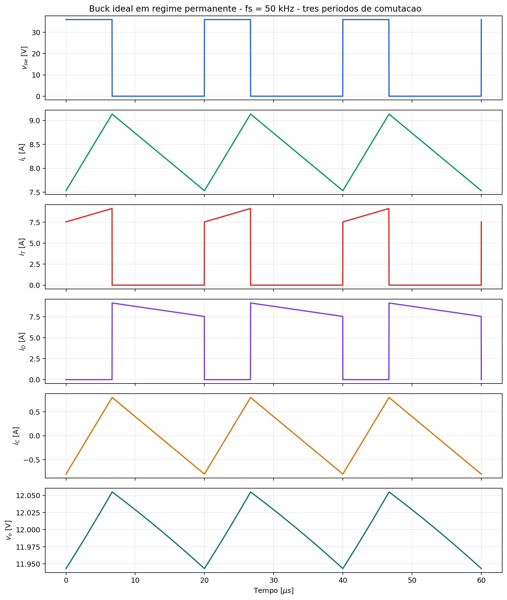
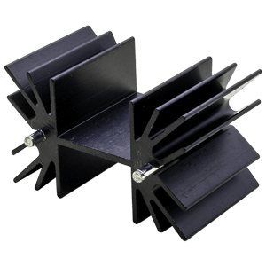
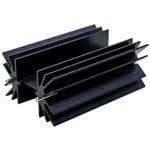
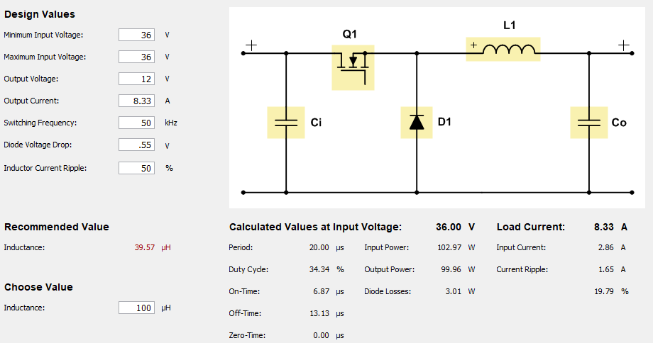
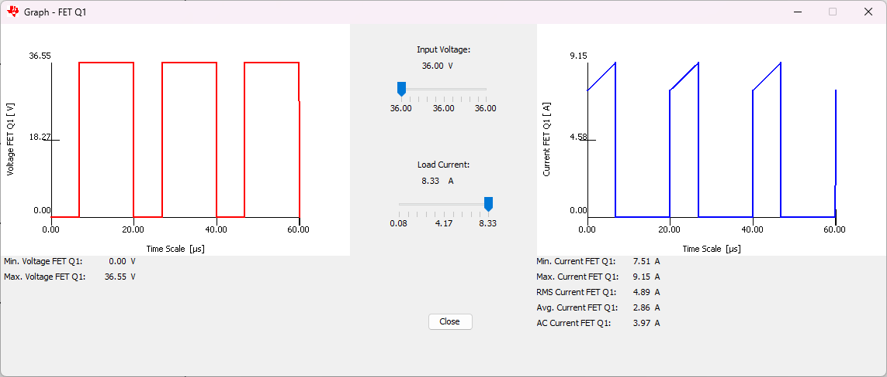
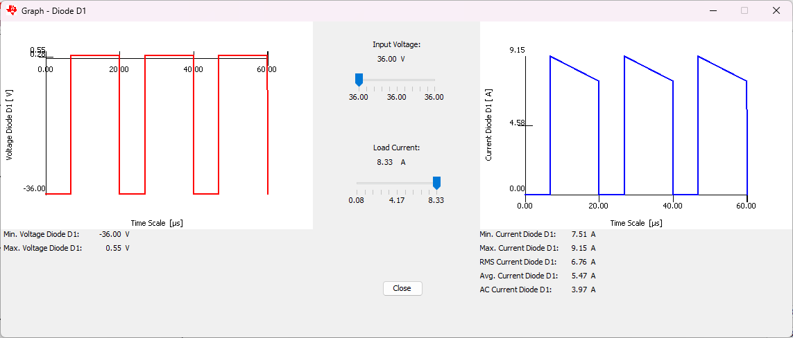
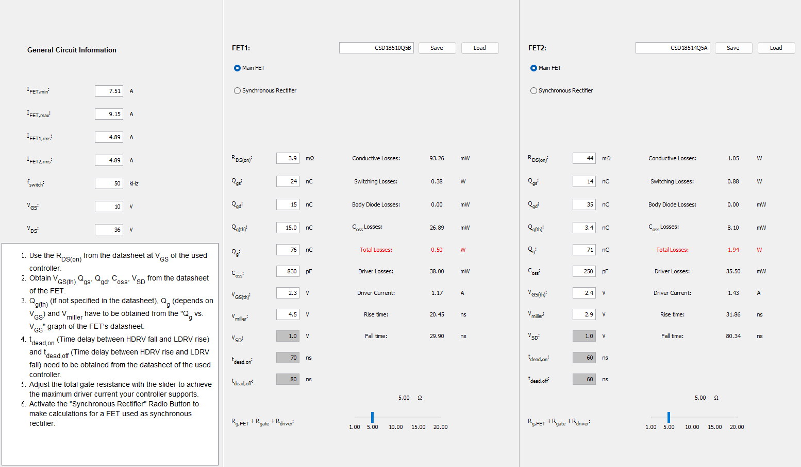

# Tarefa 02 - Projeto do Conversor Estático (Escolha de Componentes e Perdas)

**Disciplina:** Eletrônica de Potência II
**Aluno:** Mateus Salgado Barboza Costa
**Professor:** Joabel Moia
**Data:** 26/08/2026

## 1. Objetivo

Aplicar a metodologia de projeto de conversores estáticos apresentada na Aula 3 (17/08/2026) ao conversor Buck especificado, realizando a pré-escolha e a escolha final do transistor, do diodo e do capacitor de saída, calculando as perdas no transistor e especificando dissipadores, quando necessário.

## 2. Especificação e hipóteses

| Grandeza                    | Valor  |
| --------------------------- | ------ |
| Tensão de entrada, Vᵢₙ      | 36 V   |
| Tensão de saída, Vₒ         | 12 V   |
| Potência de saída, Pₒ       | 100 W  |
| Frequência de comutação, fₛ | 50 kHz |
| Indutância, L               | 100 µH |

Adotou-se regime permanente, modo de condução contínua (MCC) e carga puramente resistiva. Seguindo a recomendação da aula de **sempre fazer o projeto para pior caso**, os semicondutores foram pré-selecionados com tensão de bloqueio mínima de **2×Vᵢₙ = 72 V** (classe comercial de 100 V) e correntes com margem sobre o pico calculado. Para o cálculo térmico foram adotados Tₐ = 40 °C, meta conservadora Tⱼ,proj = 125 °C e interface cápsula-dissipador com pasta térmica, RθCS = 0,5 °C/W.

## 3. Metodologia (Aula 3)

A aula descreve a seguinte sequência para a pré-escolha dos semicondutores, seguida neste relatório:

1. **Pré-escolha** com base na corrente média, na corrente de pico e na tensão máxima de bloqueio (pior caso);
2. Redução da lista de candidatos e verificação das **características estáticas** (RDS(on), VF, RD);
3. Verificação das **características dinâmicas** (tᵣ, t_f) e de recuperação reversa (Qrr, trr);
4. **Cálculo térmico** para escolher o dissipador, se necessário, avaliando a viabilidade técnica (tamanho, peso, volume);
5. Validação das perdas por **simulação numérica** 

Para o capacitor de saída, a aula lista seis critérios de dimensionamento, capacitância mínima (a partir de ΔVo e ΔiL), tensão máxima, corrente eficaz máxima, faixa de temperatura, perdas na resistência série equivalente (RSE) e custo/volume.

## 4. Cálculos elétricos do conversor Buck

$$
D=\frac{V_o}{V_{in}}=\frac{12}{36}=0,3333 \qquad
T_s=\frac{1}{f_s}=20\ \mu s \qquad
R_o=\frac{V_o^2}{P_o}=1,44\ \Omega
$$

$$
I_o=I_{L,med}=\frac{P_o}{V_o}=8,333\ A
$$

$$
\Delta i_L=\frac{(V_{in}-V_o)D}{Lf_s}=\frac{24\times0,3333}{100\times10^{-6}\times50\times10^3}=1,600\ A
$$

$$
I_{L,min}=7,533\ A \qquad I_{L,max}=9,133\ A \qquad (I_{L,min}>0 \Rightarrow \text{MCC confirmado})
$$

### 4.1 Esforços de corrente e tensão

| Componente | Corrente média | Corrente eficaz | Corrente de pico | Tensão de bloqueio |
| ---------- | -------------- | --------------- | ---------------- | ------------------ |
| Transistor | 2,778 A        | 4,819 A         | 9,133 A          | 36 V               |
| Diodo      | 5,556 A        | 6,815 A         | 9,133 A          | 36 V               |
| Capacitor  | 0 A            | 0,462 A         | ±0,8 A           | —                  |

*Figura gerada por [calculos_buck.py](calculos_buck.py) (numpy/matplotlib, mesmo padrão gráfico da Tarefa 01). O painel de vₒ já usa o capacitor escolhido na Seção 9 (1000 µF / 70 mΩ), evidenciando o formato de "dente de serra com degraus" típico de uma ondulação dominada pela RSE.*

## 5. Pré-escolha dos semicondutores (etapa 1 do método)

Aplicando margem de pior caso (tensão ≥ 2×Vᵢₙ; corrente ≥ ~1,3× o valor de pico/médio calculado):

| Requisito                 | Transistor                                              | Diodo                      |
| ------------------------- | ------------------------------------------------------- | -------------------------- |
| Tensão de bloqueio mínima | 72 V → classe **100 V**                                 | 72 V → classe **100 V**    |
| Corrente contínua mínima  | > 9,1 A (pico)                                          | > 7,2 A (médio, c/ margem) |
| Encapsulamento            | TO-220, para reaproveitar o método térmico da Tarefa 01 | TO-220                     |

Candidatos considerados (fabricantes recomendados pela Aula 3: Infineon, Vishay, ST, ON Semi):

- **Transistores:** IRLZ44N (já usado na Tarefa 01), IRF540N (Vishay/Infineon), IPP039N10N5 (Infineon OptiMOS 5)
- **Diodos:** MUR860 (ultrarrápido, Tarefa 01), MBR20100CT (Schottky, Tarefa 01), STPS20H100C (Schottky, ST)

O **IRLZ44N é eliminado nesta etapa**: seu VDS máximo é 55 V, abaixo dos 72 V exigidos pelo critério de pior caso (Vᵢₙ pode variar na prática). Ele é mantido nas tabelas apenas como referência comparativa com a Tarefa 01.

## 6. Escolha do transistor (etapas 2 e 3 do método)

### 6.1 Características estáticas e dinâmicas

| Parâmetro              | IRLZ44N¹          | IRF540N²        | **IPP039N10N5³**   |
| ---------------------- | ----------------- | --------------- | ------------------ |
| VDS máx                | 55 V ⚠            | 100 V           | 100 V              |
| RDS(on) máx @ VGS=10 V | 22 mΩ             | 44 mΩ           | **3,9 mΩ**         |
| ID máx                 | 47 A              | 33 A            | 100 A              |
| Qg total               | 63 nC             | 71 nC           | 76 nC              |
| tᵣ / t_f               | 26 / 11 ns        | 35 / 35 ns      | **10 / 17 ns**     |
| RθJC                   | 1,4 °C/W          | 1,15 °C/W       | **0,5 °C/W**       |
| Tecnologia             | Planar (obsoleto) | Planar (HEXFET) | Trench (OptiMOS 5) |

¹ Vishay S21-1045; ² Infineon PD-94812; ³ Infineon Rev. 2.0, 2016-11-22 — ver Referências.

O IPP039N10N5 é uma peça de corrente nominal bem acima da nossa aplicação (100 A vs. 9,1 A de pico); ainda assim foi escolhido porque sua **tecnologia trench moderna reduz RDS(on) em 11× e os tempos de comutação em ~3×** comparando ao IRF540N, sem custo relevante em Qg. Isso ilustra o ponto da Aula 3 de que a escolha não deve travar apenas na corrente nominal, mas nas figuras de mérito RDS(on)×Qg e no cálculo de perdas real (Seção 7).

### 6.2 Componente escolhido

**IPP039N10N5 (Infineon OptiMOS 5, TO-220)** — atende com folga a tensão, corrente e apresenta a menor perda estimada entre os candidatos, como mostrado a seguir. O IRF540N é mantido como comparação por ser um padrão de mercado amplamente disponível.

## 7. Cálculo de perdas no transistor (entregável da tarefa)

Metodologia idêntica à Tarefa 01: fator térmico kT = 1,7 aplicado ao RDS(on) de datasheet (25 °C) para estimar a condução em Tⱼ,proj = 125 °C; comutação avaliada com a corrente de pico (pior caso) e tensão de bloqueio igual a Vᵢₙ.

$$
P_{cond}=R_{DS(on),25}\cdot k_T\cdot I_{T,rms}^2
\qquad
P_{sw}=\frac{f_s}{2}(t_r+t_f)V_{in}I_{L,max}
\qquad
P_g=Q_gV_{GS}f_s
$$

| Componente                             | P_cond  | P_sw    | P_g     | **P_total** |
| -------------------------------------- | ------- | ------- | ------- | ----------- |
| IRLZ44N (referência, VDS insuficiente) | 0,868 W | 0,304 W | 0,032 W | 1,204 W     |
| IRF540N                                | 1,737 W | 0,575 W | 0,036 W | **2,348 W** |
| **IPP039N10N5 (escolhido)**            | 0,154 W | 0,222 W | 0,038 W | **0,414 W** |

A troca do IRF540N pelo IPP039N10N5 reduz a perda total em cerca de **5,7×** (2,35 W → 0,41 W), principalmente pela redução de RDS(on) (queda de 92% na perda de condução, o termo dominante neste conversor, já que D = 33% mantém o transistor conduzindo por um terço do período com corrente elevada).

## 8. Escolha do diodo

### 8.1 Comparação de candidatos

| Parâmetro        | MUR860¹           | MBR20100CT²        | **STPS20H100C³**       |
| ---------------- | ----------------- | ------------------ | ---------------------- |
| Tecnologia       | Ultrarrápido (Si) | Schottky           | Schottky               |
| VRRM             | 600 V             | 100 V              | 100 V                  |
| IF(AV)           | 8 A               | 2×10 A             | 2×10 A                 |
| VF (10 A, 25 °C) | ~1,2 V (150 °C)   | 0,65 V (típ.)      | 0,77 V                 |
| Qrr              | 195 nC            | — (Schottky)       | — (Schottky)           |
| RθJC             | 2,0 °C/W          | 2,0 °C/W por perna | **0,9 °C/W por perna** |
| Tⱼ máx           | 175 °C            | 150 °C             | **175 °C**             |

¹ dado usado na Tarefa 01; ² Vishay MBR20xxxCT-E3; ³ ST DS5386 Rev. 7 — ver Referências.

O diodo é o componente mais crítico termicamente no Buck: ele conduz **66,7 % do período** (1 − D), contra apenas 33,3 % do transistor, resultando em corrente eficaz maior (6,815 A vs. 4,819 A).

### 8.2 Perdas de condução (modelo VF = V₀ + Rd·I)

| Diodo                               | Modelo                                           | P_cond                      | RθJC efetivo  |
| ----------------------------------- | ------------------------------------------------ | --------------------------- | ------------- |
| MUR860                              | VF constante + Qrr·Vin·fs                        | 6,667 + 0,351 = **7,018 W** | 2,0 °C/W      |
| MBR20100CT                          | VF constante (único ponto de datasheet)          | **3,611 W**                 | 2,0 °C/W      |
| STPS20H100C, um terminal            | V₀=0,55 V, Rd=9 mΩ (ajuste @125 °C)              | **3,474 W**                 | 0,9 °C/W      |
| **STPS20H100C, ânodos em paralelo** | idem, corrente dividida nas duas pernas internas | **3,265 W**                 | **0,45 °C/W** |

Seguindo a mesma prática adotada com o MBR20100CT na Tarefa 01, os dois ânodos internos do STPS20H100C (cátodo comum) foram ligados em paralelo. O ganho em perda é modesto (~6 %, pois só o termo resistivo Rd é dividido), mas o **RθJC efetivo cai pela metade**, o que folga bastante o dimensionamento do dissipador (Seção 10).

### 8.3 Componente escolhido

**STPS20H100C (ST), com os dois ânodos internos em paralelo**, menor perda total, menor RθJC efetivo e maior margem de temperatura de junção (175 °C) que as demais opções.

## 9. Dimensionamento do capacitor de saída

Seguindo os seis critérios da Aula 3 (capacitância mínima, tensão máxima, corrente eficaz máxima, faixa de temperatura, perdas na RSE, custo/volume):

### 9.1 Capacitância mínima e RSE máxima

Meta de ondulação de saída: ΔVo ≤ 1 % de Vo = 120 mV.

$$
C_{min}=\frac{\Delta i_L}{8f_s\Delta V_o}=\frac{1,6}{8\times50\times10^3\times0,12}=33,3\ \mu F
$$

$$  
RSE_{max}=k\cdot\frac{\Delta V_o}{\Delta i_L}=0,2\times\frac{0,12}{1,6}=15\ m\Omega  
$$

### 9.2 Corrente eficaz e tensão

$$
I_{C,rms}=\frac{\Delta i_L}{\sqrt{12}}=0,462\ A \qquad V_C \ge 1,5\text{ a }2\times V_o \Rightarrow \textbf{25 V}
$$

### 9.3 Componente escolhido

**Nichicon UPW1E102MHD — 1000 µF / 25 V**, série de baixa impedância (ESR = 70 mΩ típ. @ 100 kHz/20 °C, corrente de ripple 1,66 A @ 105 °C, vida útil 7000 h @ 105 °C).

| Grandeza                                                | Valor                       |
| ------------------------------------------------------- | --------------------------- |
| ΔVo (parcela capacitiva, isolada)                       | 4,0 mV                      |
| ΔVo (parcela da RSE, isolada)                           | 112,0 mV                    |
| ΔVo total, soma das parcelas (estimativa conservadora)  | 116,0 mV                    |
| **ΔVo total, forma de onda simulada** (Fig. da Seção 4) | **112,0 mV (0,93 % de Vo)** |
| Folga de corrente de ripple                             | 1,66 A / 0,462 A ≈ **3,6×** |
| P_RSE                                                   | 14,9 mW (desprezível)       |

O capacitor atende à meta de 1 % mesmo sem RSE dedicada abaixo de 15 mΩ, porque o valor de 1000 µF (muito acima do C_min de 33,3 µF) já é suficiente para trazer a ESR típica da série para 70 mΩ. Como a temperatura ambiente de projeto (40 °C) e a corrente de ripple real estão bem abaixo dos valores nominais do capacitor (105 °C / 1,66 A), a vida útil esperada em operação é várias vezes maior que as 7000 h de catálogo

## 10. Dimensionamento térmico e dissipadores (etapa 4 do método)

$$
R_{\theta SA,max}=\frac{T_{j,proj}-T_a}{P}-R_{\theta JC}-R_{\theta CS}
\qquad (T_{j,proj}=125\ °C,\ T_a=40\ °C,\ R_{\theta CS}=0,5\ °C/W)
$$

### 10.1 Transistor — IPP039N10N5

|                                        | Valor      |
| -------------------------------------- | ---------- |
| Perda total                            | 0,414 W    |
| RθJA requerido (sem dissipador)        | 205,4 °C/W |
| RθJA de catálogo (TO-220, ao ar livre) | 40–62 °C/W |

Como o RθJA natural do encapsulamento (40–62 °C/W) já é **muito menor** que o requerido (205,4 °C/W), **o transistor dispensa dissipador**.

### 10.2 Diodo — STPS20H100C (ânodos em paralelo)

|                        | Valor         |
| ---------------------- | ------------- |
| Perda total            | 3,265 W       |
| RθJC efetivo           | 0,45 °C/W     |
| **RθSA,max requerida** | **25,1 °C/W** |

O diodo **necessita de dissipador**: RθSA,max = 25,1 °C/W é uma exigência moderada. A simulação no Power Stage Designer 5 (Seção 11.4) confirma essa exigência, com folga ligeiramente maior (27,3 °C/W).

**Dissipador recomendado: Same Sky HSE17-252525P** (mesmo modelo avaliado na Tarefa 01 para o MBR20100CT):

- Tipo: Alumínio extrudado, TO-220
- Dimensões: 25 × 25 × 25 mm
- RθSA: 12,6 °C/W @ 1 W (convecção natural) — mais de 2× de margem sobre os 25,1–27,3 °C/W requeridos
- Montagem: Clip ou parafuso
- Aplicação: Diodo Schottky STPS20H100C — dissipação principal do conversor

**Alternativa com mais margem: Same Sky HSE15-644225P:**

- Tipo: Alumínio extrudado, TO-220
- Dimensões: 64 × 42 × 25 mm
- RθSA: 7 °C/W @ 1 W (convecção natural)
- Montagem: Clip ou parafuso
- Aplicação: Recomendado se a temperatura ambiente real superar os 40 °C de projeto

### 10.3 Capacitor

Perda de 14,9 mW, Sem Dissipador.

### 10.4 Resumo

| Componente                     | Perda (W) | Dissipador necessário?           |
| ------------------------------ | --------- | -------------------------------- |
| Transistor IPP039N10N5         | 0,414     | **Não**                          |
| Diodo STPS20H100C (paralelo)   | 3,265     | **Sim** — Same Sky HSE17-252525P |
| Capacitor Nichicon UPW1E102MHD | 0,015     | Não                              |

## 11. Validação por simulação (Power Stage Designer 5)

### 11.1 Ambiente de simulação

- Software: Power Stage Designer, versão 5.0 (TI)
- Topologia: Buck
- Componentes: IPP039N10N5 (transistor, FET Losses Calculator), STPS20H100C (diodo, modelado por queda de tensão direta Vf = 0,55 V), indutor 100 µH
- Condição de operação: Vin = 36 V, Vout = 12 V, Iout = 8,33 A, fs = 50 kHz

### 11.2 Comparação teórico × simulado

| Grandeza                       | Teórico (Seção 4) | PSD5            | Δ (%)                              |
| ------------------------------ | ----------------- | --------------- | ---------------------------------- |
| Vo médio                       | 12,000 V          | 12,00 V         | 0,0 %                              |
| Duty cycle                     | 33,33 %           | 34,34 %         | +3,0 % *(PSD5 inclui Vf do diodo)* |
| IL médio                       | 8,333 A           | 8,33 A          | −0,04 %                            |
| ΔiL pico a pico                | 1,600 A           | 1,65 A          | +3,1 %                             |
| IL,rms                         | 8,346 A           | 8,34 A          | −0,07 %                            |
| IT,rms                         | 4,819 A           | 4,89 A          | +1,5 %                             |
| ID,rms                         | 6,815 A           | 6,76 A          | −0,8 %                             |
| IC,rms                         | 0,462 A           | 0,476 A         | +3,0 %                             |
| **P_transistor (IPP039N10N5)** | 0,414 W           | **0,50 W**      | +20,8 %                            |
| **P_diodo (STPS20H100C)**      | 3,265 W           | **3,01 W**      | −7,8 %                             |
| ΔVo pico a pico                | 112,0 mV          | *não avaliável* | —                                  |

Todos os esforços de corrente/tensão (IL, IT,rms, ID,rms, IC,rms) ficaram a **menos de 3,1 % de diferença** do cálculo analítico da Seção 4 

### 11.3 Perdas do transistor — detalhamento e comparação com o IRF540N

O **FET Losses Calculator** do PSD5 permite comparar dois FETs lado a lado sob a mesma condição de acionamento (VGS = 10 V, Rg,total = 5 Ω — mesma resistência de gate para os dois, para uma comparação justa):

| Parcela de perda | IPP039N10N5 (escolhido) | IRF540N (comparação) |
| ---------------- | ----------------------- | -------------------- |
| Condução         | 93,3 mW                 | 1,05 W               |
| Comutação        | 0,38 W                  | 0,88 W               |
| Coss             | 26,9 mW                 | 8,1 mW               |
| Driver (gate)    | 38,0 mW                 | 35,5 mW              |
| **Total**        | **0,50 W**              | **1,94 W**           |

Sob acionamento idêntico, o IPP039N10N5 dissipa **≈3,9× menos** que o IRF540N , confirma de forma independente, com outra ferramenta, a escolha de transistor justificada na Seção 6.

### 11.4 Revisão do dimensionamento térmico com os valores do PSD5

Repetindo o cálculo da Seção 10 com as perdas medidas no PSD5:

$$
R_{\theta JA,requerido}(\text{transistor}) = \frac{125-40}{0,50} = 170\ °C/W \quad (\gg 40\text{–}62\ °C/W\ \text{de catálogo} \Rightarrow \text{ainda dispensa dissipador})
$$

$$
R_{\theta SA,max}(\text{diodo}) = \frac{125-40}{3,01} - 0,45 - 0,5 = 27,3\ °C/W \quad (\text{vs. } 25,1\ °C/W\ \text{calculado} - \text{exigência praticamente igual, levemente mais folgada})
$$

**As conclusões da Seção 10 permanecem válidas**: o transistor dispensa dissipador com folga ainda maior que a calculada, e o diodo continua exigindo um dissipador compacto (agora com ≈27 °C/W de margem em vez de 25 °C/W).

## 12. Conclusão

A aplicação da metodologia da Aula 3 (pré-escolha por tensão/corrente de pior caso → verificação de características estáticas e dinâmicas → cálculo de perdas → dimensionamento térmico) resultou na escolha do **MOSFET IPP039N10N5**, do **diodo Schottky STPS20H100C** (ânodos em paralelo) e do **capacitor eletrolítico Nichicon UPW1E102MHD (1000 µF/25 V)**.

O resultado mais relevante do projeto é a assimetria térmica entre transistor e diodo: como o diodo conduz o dobro do tempo do transistor (1 − D = 66,7 % contra D = 33,3 %) e não se beneficia da baixíssima queda resistiva de um MOSFET moderno, ele concentra a maior parte das perdas (3,01–3,27 W contra 0,41–0,50 W) e é o único semicondutor que **exige dissipador**. A escolha de um MOSFET de tecnologia trench moderna, por outro lado, eliminou completamente a necessidade de dissipador no transistor, um ganho direto de custo, volume e simplicidade de montagem frente à alternativa clássica (IRF540N), que teria quase 4× mais perdas e exigiria dissipador . O capacitor de saída, dimensionado pelo critério de RSE (e não apenas de capacitância, conforme ensinado na aula), atende à meta de 1 % de ondulação com folga de corrente de ripple superior a 3×.

A validação numérica prevista na etapa 5 do método (Seção 11) foi feita no **Power Stage Designer 5**, com todos os esforços de corrente e tensão confirmados a menos de 3,1 % do cálculo analítico, e as perdas dentro da mesma ordem de grandeza (diferenças de 8–21 %, explicadas pelos diferentes modelos de comutação empregados). As conclusões de dimensionamento térmico (Seção 10) permanecem válidas após a validação.

## Referências

- Prof. Joabel Moia. *Apresentação Aula 03 — Metodologia de Projeto aplicada em conversores estáticos de potência*. IFSC, agosto de 2026.
- Vishay. *IRLZ44 / IRLZ44N Power MOSFET Datasheet*, S21-1045. [https://www.vishay.com/docs/91328/irlz44.pdf](https://www.vishay.com/docs/91328/irlz44.pdf)
- Infineon. *IRF540NPbF HEXFET Power MOSFET Datasheet*, PD-94812. [https://www.infineon.com/assets/row/public/documents/24/49/infineon-irf540n-datasheet-en.pdf](https://www.infineon.com/assets/row/public/documents/24/49/infineon-irf540n-datasheet-en.pdf)
- Infineon. *IPP039N10N5 OptiMOS 5 Power-Transistor Datasheet*, Rev. 2.0, 2016-11-22. [https://www.infineon.com/dgdl/Infineon-IPP039N10N5-DS-v02_00-EN.pdf](https://www.infineon.com/dgdl/Infineon-IPP039N10N5-DS-v02_00-EN.pdf)
- Vishay. *MBR20xxxCT-E3 / MBRF20xxxCT-E3 Schottky Rectifier Datasheet*. [https://www.vishay.com/docs/89033/mbr20100.pdf](https://www.vishay.com/docs/89033/mbr20100.pdf)
- STMicroelectronics. *STPS20H100C / STPS20H100CT High-Junction-Temperature Power Schottky Rectifier*, DS5386 Rev. 7. [https://www.st.com/resource/en/datasheet/stps20h100c.pdf](https://www.st.com/resource/en/datasheet/stps20h100c.pdf)
- ON Semiconductor. *MBR20100CT Schottky Rectifier Datasheet*. [https://www.onsemi.com/pdf/datasheet/mbr20100ct-d.pdf](https://www.onsemi.com/pdf/datasheet/mbr20100ct-d.pdf)
- Nichicon. *UPW Series — Miniature Aluminum Electrolytic Capacitors (Low Impedance)*, datasheet UPW1E102MHD.
- Texas Instruments. *Power Stage Designer User's Guide*, SLVUBB4B, novembro de 2017 (revisado fevereiro de 2023). [https://www.ti.com/lit/pdf/slvubb4](https://www.ti.com/lit/pdf/slvubb4)
- Texas Instruments. *Power Stage Designer* (ferramenta de software), versão 5.0. [https://www.ti.com/tool/POWERSTAGE-DESIGNER](https://www.ti.com/tool/POWERSTAGE-DESIGNER)
- Tarefa 01 — *Cálculo Térmico e Dissipador* (mesmo aluno/disciplina), para os dados do MUR860 e a metodologia térmica base, e para o precedente de uso do Power Stage Designer 5.

